# Welcome {background-color="#385898"}

## Outline

The course runs about three hours, with a break after Parts 1 and 2.

| | Topic | Instructor |
| ----- | ------------------------------- | ---------- |
| Part 1 | **AI agents and AI-first workflow** | Yilong |
| Part 1 | **Agentic CDISC data standardization** | Yilong |
| Break | | |
| Part 2 | **LLM and agents for statistical programming** | Jimeng |
| Break | | |
| Part 3 | **Benchmarks** | Yilong |
| Part 3 | **Case study: reviewing benchmarks** | Jimeng and Yilong |

## Disclaimer

The views and opinions expressed in this presentation are those of the
individual presenters. They do not represent those of their affiliated
organizations or institutions.

## Training objectives

This workshop aims to help you:

* Understand the building blocks of an agentic workflow, with CDISC data
  standardization as one example.
* Recognize where an AI agent's performance may be improved.
* Get started with creating and reviewing benchmarks that assess AI agents.

::: callout-note
Toolchains, processes, and formats differ across organizations.
This workshop shows one possible approach, not the only one.
:::

## Resources

* During the workshop, we will use three projects:
  - [yamaa](https://github.com/elong0527/yamaa): tools and benchmarks for CDISC data standardization.
  - [R Consortium Pilot 7 project](https://github.com/RConsortium/submissions-pilot7-synthetic-data): synthetic trials that demonstrate CDISC data standardization.
  - [ai4csr](https://ai4csr.org/): the book and slides for this short course.

* Post your questions in the group chat.

# AI agents {background-color="#385898"}

::: {.section-brief}
**You will:** name the parts of an AI agent and say what each one can and
cannot do.
:::

## Example: arena.ai

[Try it at arena.ai/agent](https://arena.ai/agent){.try-it}

:::: {.columns}

::: {.column width="50%"}
::: {.prompt}
Use the Pilot 5 ADSL dataset to generate a baseline characteristics table
using R and gtsummary.

Data: <https://github.com/RConsortium/submissions-pilot7-synthetic-data/tree/main/submission-pilot5/data/adam>
:::
:::

::: {.column width="50%"}
To finish, the agent has to:

1. Find `adsl.parquet` in the folder.
2. Read it in R.
3. Pick the population, arms, and grouping variables.
4. Build the table with gtsummary.
5. Return the table and its code.
:::

::::

**What to check:** the prompt never names the population, variables, or
statistics, so the agent has to guess them. Do they match your table shell?

## Example: Muse

[Try it at muse.ai](https://muse.ai){.try-it}

:::: {.columns}

::: {.column width="60%"}
Muse is a personal agent from Meta. "Give Muse a goal or task and it handles
the rest": sort email, book a dinner, or fill out a form.

Muse also helps me maintain open-source projects in the background:

- Identify project gaps from published PHUSE papers.
- Bring new benchmark ideas for CDISC standardization.
:::

::: {.column width="40%"}

:::

::::

## What is an AI agent?

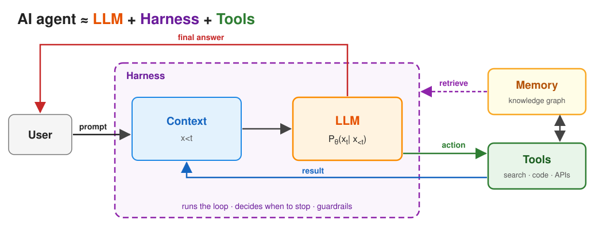

## What is a large language model?

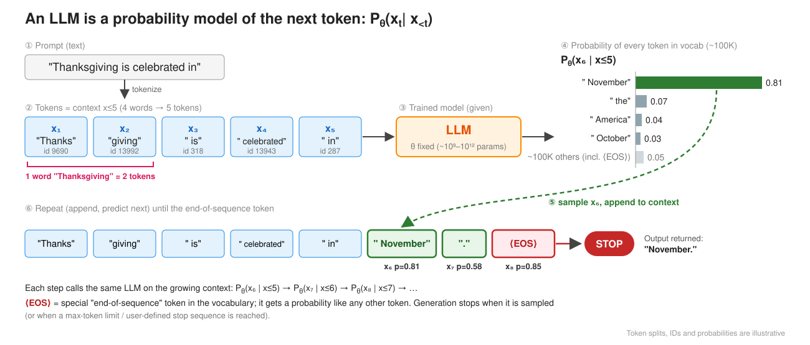

An LLM only predicts the next token from its context. It cannot open a file or
run code: a harness does that and puts the results back into the context.

## What is a harness?

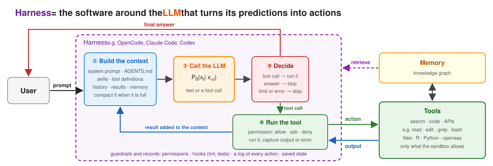

> The LLM is like the CPU; the harness is like the operating system.

## Reference: Agent vocabulary

::: {.glossary}
| Term | Meaning |
| ----- | -------------------- |
| Prompt | The request, with every rule you wrote into it. |
| Token | A word or part of a word: the unit a model reads and writes. |
| Context | The ordered tokens the model sees in one call: prompt, files read, tool results. |
| LLM | Predicts the next token from the context. |
| Harness | Builds the context, calls the model, runs tools, logs each step: OpenCode. |
| Tool | A program the harness runs for the model: read a file, run R. |
| Skill | Task instructions the harness loads: the agent's SOP. |
| Agent | LLM, harness, and tools, looping until the task is done. |
:::

# AI-first workflow {background-color="#385898"}

::: {.section-brief}
**You will:** design an AI-first workflow and the principles that keep it
trustworthy.
:::

## A mental game

:::: {.columns}

::: {.column width="55%"}
::: {.scenario}
**Shaping an AI-Native Biometrics Group from Day 0**

**What would you do?**

You have been hired by the CMO to build a biometrics group.
:::
:::

::: {.column width="45%"}
#### Blank Slate

- No legacy systems to migrate.
- No "we've always done it this way" culture.

#### Rare Opportunity

- Build an AI-native group from scratch.
- Skip the "digital transformation" pain.
:::

::::

> *Let's brainstorm the strategy for a small- to midsize biopharma company.*

## What is AI-native?

> AI-native is an organization whose workflows are mostly AI-first and
> connected through shared, inspectable artifacts.

::: {.ai-levels}
| AI adoption | AI-first | AI-native |
| --- | --- | --- |
| **AI added to existing work** | **AI is the default starting point** | **AI is a core collaborator** |
| AI helps with isolated tasks; the workflow does not change. | AI starts and executes the tasks of some workflows. | AI-human collaboration is designed across workflows. |
| *Example: ChatGPT drafts an email or summarizes a document.* | *Example: every analysis starts with a prompt to an AI agent.* | *Example: AI agents run CDISC data standardization end to end.* |
:::

> **AI-native is a mindset, not a tool:** every team member orchestrates AI
> agents, handles the exceptions, and keeps improving the system.

## Design an AI-first workflow

> Let's design an AI-first workflow for CDISC data standardization.

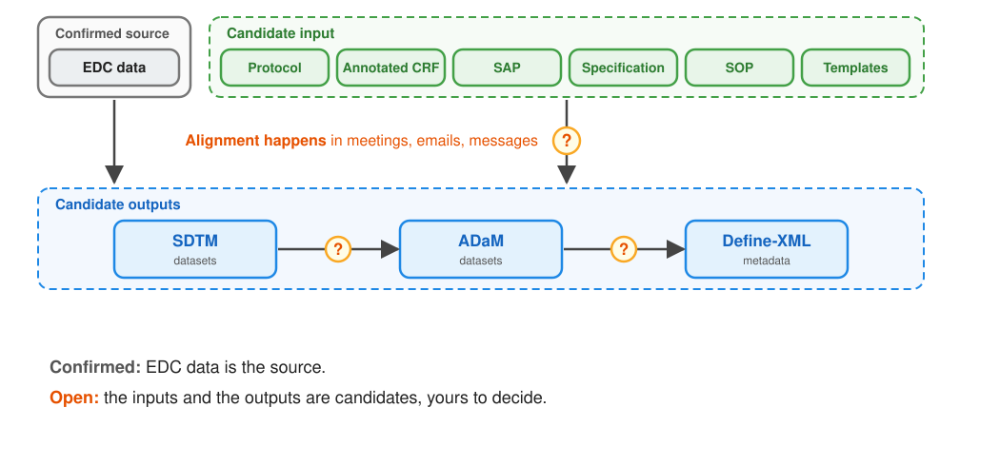

## Brainstorm: where to start building

You will build an AI agent for this workflow. **Where do you start, and why?**

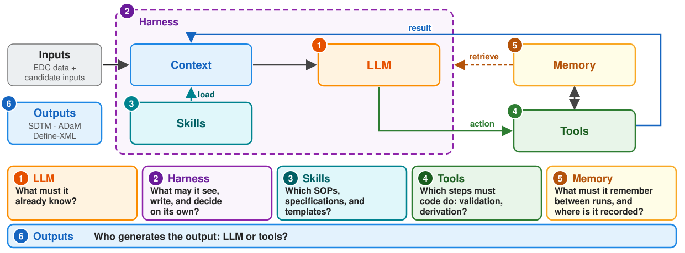

## Opinionated proposal

- As a Biometrics organization, focus on defining the workflow.
- Leverage internal and external AI infrastructure, with proper skills and tools.

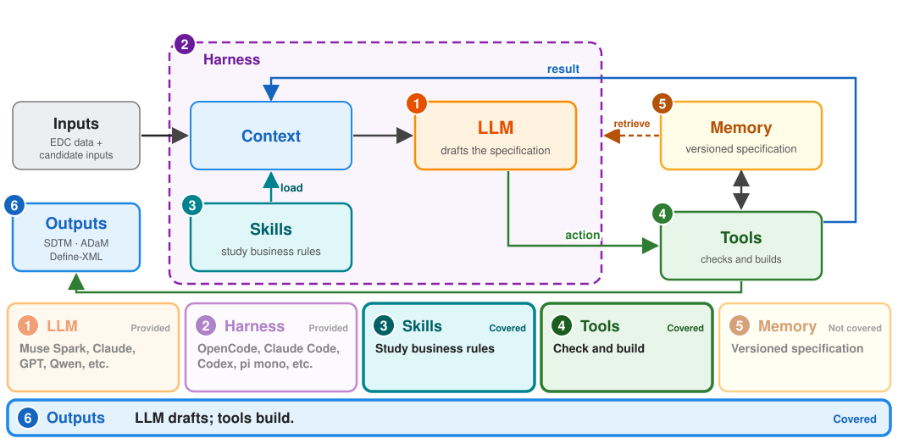

## Agentic workflow design principles

> **Primary goal: trustworthy assistance.** The agent's work can be inspected,
> repeated, challenged, and reviewed.

::: {.principles}
| Principles | Goal |
| -------------------------- | ------------ |
| Plain text first | Inspectable artifacts |
| Single source of truth | Explicit state |
| Deterministic first | Tools and evidence |
| Agent-specific identity | Attributable actions |
:::

For CDISC data standardization, we recommend:

- Do not use the annotated CRF as an input; generate it as an output.
- Do not use a specification in Excel, Word, or PDF as an input; use a plain-text specification.

# Agentic CDISC data standardization {background-color="#385898"}

::: {.section-brief}
**You will:** see why agents disagree on CDISC derivations and how a reviewed,
plain-text specification removes the guesswork.
:::

## Contributors {.center}

::: {.center-body-left}
- **Peng Zhang** CIMS Global
- **Bingjun Wang** Genentech
- **Ming-chun Chen** Summit Therapeutics
- **Jingwei Xiong** Merck & Co., Inc
- **Yilong Zhang** BBSW AI Committee
:::

## Motivation

* Two AI agents derive the same analysis dataset from the same specification
  ([example from arena.ai](https://arena.ai/c/01a18ded-d0db-7852-b6e9-1528ddf4eb42)).
* Both report success, but their code and outputs may differ.
* A reviewer must resolve every difference before signing off.

From an FDA [warning letter](https://www.fda.gov/inspections-compliance-enforcement-and-criminal-investigations/warning-letters/purolea-cosmetics-lab-722591-04022026).

> "you must review the AI-generated documents to ensure they were accurate and actually compliant..."

## One root cause

* The user prompt leaves business rules implicit, so agents must infer them.
* Business rules can differ from language defaults:
  * [R](https://stat.ethz.ch/R-manual/R-devel/library/base/html/Round.html) and [Python](https://docs.python.org/3/library/functions.html#round) round ties to even.
  * [SAS](https://documentation.sas.com/api/docsets/lrcon/9.4/content/lrcon.pdf) compares missing numeric values as lower than non-missing values.

## Evidence: prompt completeness decides success

| Prompt tier | Python | R | opensas |
| --- | --- | --- | --- |
| Full | 99.3% (133/134) | 98.5% (132/134) | 86.6% (116/134) |
| Conventions | 35.8% (48/134) | 33.6% (45/134) | 34.3% (46/134) |
| Brief | 18.7% (25/134) | 17.9% (24/134) | 15.7% (21/134) |

**Same 134 tasks, same agent; only the prompt changed.** Writing the business
rules into the prompt lifts the pass rate from under 20% to over 85%.

::: {style="font-size: 75%;"}
opensas: <https://github.com/kirha-ai/opensas><br>
Agent: opencode 1.18.33. Model: opencode-go/muse-spark-1.3-contributor, 1 attempt, Oct 12 2026
:::

## Mean arterial pressure: three prompts {.map-prompts}

::: {.map-shared}
**Shared Prompt:**

- derive `ADVS` from the provided `ADVS` dataset using CDISC ADaM standards; one record per subject, visit, and parameter.
- `STUDYID, USUBJID, PARAMCD, PARAM, AVAL, VISIT, DTYPE`
- read from `/app/input`; write `/app/output/advs.csv`.
:::

::: {.map-comparison}
| Rule in the prompt | Full - **passes** | Conventions - **passes** | Brief - **fails** |
| --- | --- | --- | --- |
| MAP identifiers | `PARAMCD = "MAP"`<br>`PARAM = "Mean Arterial Pressure (mmHg)"` | Same MAP identifiers | Not stated |
| Records to add | One per subject and visit with both `SYSBP` and `DIABP`; none when either is absent or missing. | Not stated | Not stated |
| `AVAL` | Two-thirds `DIABP` plus one-third `SYSBP`;<br>not rounded. | Not rounded;<br>formula not stated. | Not stated |
| `DTYPE` | Added record: `CALCULATION`.<br>Collected records: no value. | `CALCULATION` or no value;<br>assignment not stated. | Not stated |
:::
::: {.map-takeaway}
**Brief omits both the MAP formula and the rule for adding a record.**<br>
`SYSBP` = systolic blood pressure; `DIABP` = diastolic blood pressure.<br>
<https://elong0527.github.io/yamaa/benchmark/adam-advs-map.html>
:::

## Goal

- Reduce human review effort.
- Leverage organization templates.
- Capture business rules that AI agents can apply.
- Move human-AI collaboration to the planning stage.

## yamaa: collaboration at the planning stage

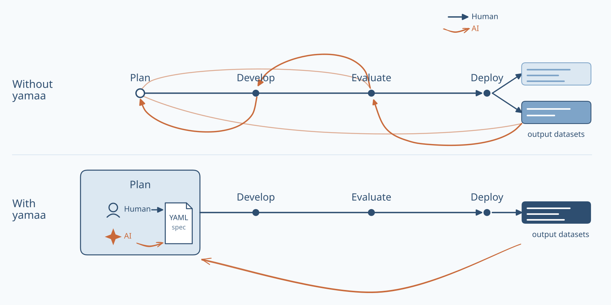

Human and AI review the specification during planning; the engine executes the agreed rules.

## yamaa: YAML specification example

```yaml
yamaa: "1.0"
type: spec
model: ADaM
domain: ADSL
keys: [STUDYID, USUBJID]
input:
  SOURCE:
    path: input/adsl.csv
    types: {HEIGHTCM: float, WEIGHTKG: float}

output:
  path: adsl.csv
  columns: [STUDYID, USUBJID, BMI]

columns:
  - {name: STUDYID, type: str, label: Study Identifier, derivation: SOURCE.STUDYID}
  - {name: USUBJID, type: str, label: Unique Subject Identifier, derivation: SOURCE.USUBJID}
  - {name: HEIGHTCM, type: float, label: Height (cm), derivation: SOURCE.HEIGHTCM}
  - {name: WEIGHTKG, type: float, label: Weight (kg), derivation: SOURCE.WEIGHTKG}
  - name: BMI
    type: float
    label: Body Mass Index (kg/m2)
    derivation: "WEIGHTKG / POWER(NULLIF(HEIGHTCM, 0) / 100, 2)"
```

## yamaa: core principle

> A yamaa specification has exactly one execution. Where it would have two,
> yamaa fails instead of choosing.

::: {.formula}
*`output_dataset = derive(input_datasets, spec)`*
:::

The specification is a contract between people and AI agents:

- **spec:** written in the closed vocabulary of the schema.
- **derive:** applies each business rule with one defined meaning.

## yamaa: where the uncertainty lives

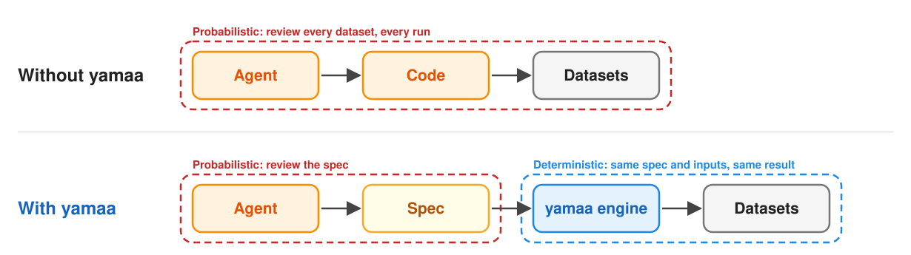

The AI agent is probabilistic, so people review the specification. The engine
that executes it is deterministic: the same specification and inputs give the
same datasets.

## yamaa: inheritance

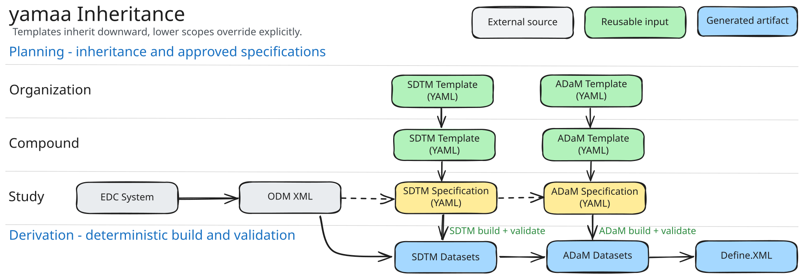

Inheritance reduces duplication while keeping every resolved study specification self-contained and reviewable.
([example](https://elong0527.github.io/yamaa/benchmark/schema-inheritance.html))

## yamaa reproduces R Submission Pilot 5 {.perf}

- [Pilot 5 dashboard](https://rconsortium.github.io/submissions-pilot7-synthetic-data/studies/submission-pilot5/#submission-pilot5/datasets/ADSL)

::: {.perf-grid}
::: {.perf-panel}
<div class="perf-title">Real size: 254 subjects</div>

<div class="perf-group">End-to-end time, 1 core</div>
<div class="perf-row yamaa"><span class="perf-label">R (yamaa)</span><span class="perf-track"><span class="perf-bar" style="width: 6.1%"></span></span><span class="perf-value">1.62 s</span></div>
<div class="perf-row"><span class="perf-label">R (admiral)</span><span class="perf-track"><span class="perf-bar" style="width: 100%"></span></span><span class="perf-value">26.45 s</span></div>
<div class="perf-group">Peak memory</div>
<div class="perf-row yamaa"><span class="perf-label">R (yamaa)</span><span class="perf-track"><span class="perf-bar" style="width: 41.1%"></span></span><span class="perf-value">0.25 GB</span></div>
<div class="perf-row"><span class="perf-label">R (admiral)</span><span class="perf-track"><span class="perf-bar" style="width: 100%"></span></span><span class="perf-value">0.60 GB</span></div>
:::

::: {.perf-panel}
<div class="perf-title">Stress test: 10x subjects (2,540)</div>

<div class="perf-group">End-to-end time, 1 core</div>
<div class="perf-row yamaa"><span class="perf-label">R (yamaa)</span><span class="perf-track"><span class="perf-bar" style="width: 6.9%"></span></span><span class="perf-value">12.62 s</span></div>
<div class="perf-row"><span class="perf-label">R (admiral)</span><span class="perf-track"><span class="perf-bar" style="width: 100%"></span></span><span class="perf-value">181.70 s</span></div>
<div class="perf-group">Peak memory</div>
<div class="perf-row yamaa"><span class="perf-label">R (yamaa)</span><span class="perf-track"><span class="perf-bar" style="width: 46.6%"></span></span><span class="perf-value">1.93 GB</span></div>
<div class="perf-row"><span class="perf-label">R (admiral)</span><span class="perf-track"><span class="perf-bar" style="width: 100%"></span></span><span class="perf-value">4.13 GB</span></div>
:::
:::

- R (yamaa) vs. original R (admiral): 14--16x faster, 2.1--2.4x less memory.

## Summary of the workflow

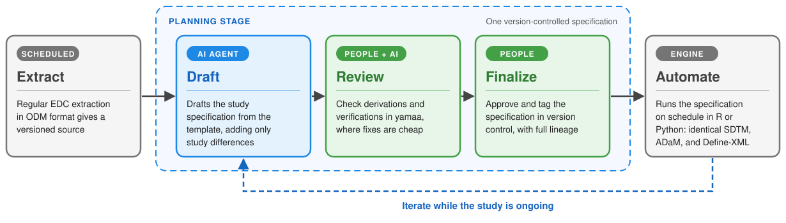

People and AI agents collaborate on one version-controlled specification at
the planning stage, while the study is ongoing.

# Benchmarks {background-color="#385898"}

::: {.section-brief}
**You will:** see what a benchmark measures, how Harbor grades an agent, and
what a pass rate cannot tell you.
:::

## What is a benchmark?

> A benchmark is a fixed task with an independently authored answer, so an
> agent's work is measured, not judged by eye.

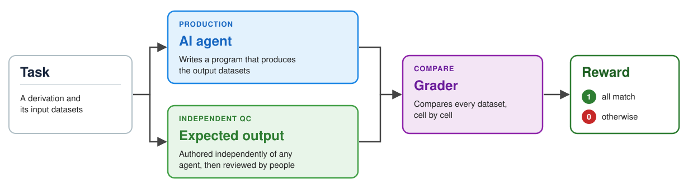

**Like double programming:** the agent is the production programmer, the
expected output is the independent QC, and the grader compares the two
datasets value by value.

## Benchmark for SDTM and ADaM

**Goal:** test whether an AI agent can derive SDTM and ADaM datasets.

::: {.roles}
| Expectation | What each task needs | Example |
| ------ | ------------ | ------------ |
| **Relevant** | One real-study derivation | Study day in `VS`, age groups in `ADSL` |
| **Edge cases** | Inputs where two programmers could disagree | Partial dates: `2024-03` (no day), `2024` (no month) |
| **Reviewed by experts** | Experts confirm the task, inputs, and expected output | Draft, reviewed, finalized; only people finalize |
:::

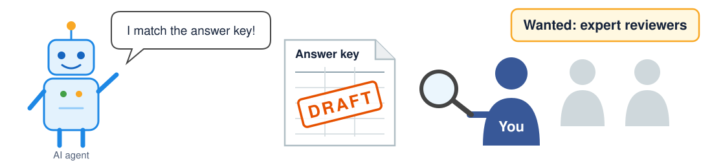{fig-align="center" width="85%"}

## yamaa benchmarks

:::: {.columns}
::: {.column width="48%"}
::: {.big-number}
~ 200
:::
::: {.metric-label}
benchmarks
:::
:::

::: {.column width="48%"}
::: {.big-number}
3
:::
::: {.metric-label}
execution interfaces (Python, R, CLI)
:::
:::
::::

- [Explore all benchmarks](https://elong0527.github.io/yamaa/benchmark/).

<iframe class="benchmark-embed r-stretch" src="https://elong0527.github.io/yamaa/benchmark/adam-adsl-age-group.html" title="Age Groups benchmark dashboard"></iframe>

Scroll inside the frame to see the specification, inputs, and expected output.

## Benchmark review progress

Each square is one benchmark; hover for its name, or select it to open the
benchmark.

::: {#review-heatmap .review-heatmap}
:::

<script src="review-heatmap.js"></script>

## Harbor: run and grade an agent

[Harbor](https://github.com/harbor-framework/harbor) runs an agent on each
benchmark task and grades the result. It produced the Part 1 prompt-tier
results; [join yamaa on Harbor Hub](https://hub.harborframework.com/invite/7chJ24hLaint4KnmK5VSTnW-Sow1D2yc)
to explore them.

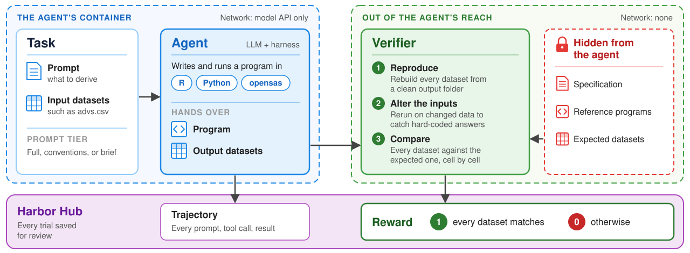

## Benchmark limitations

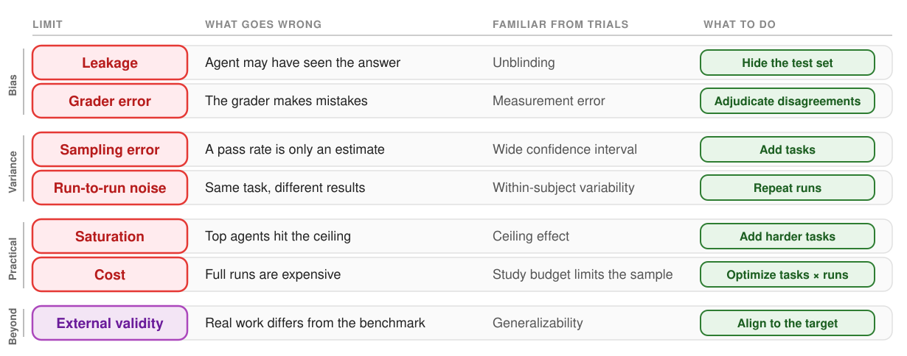

## From benchmarks to real studies

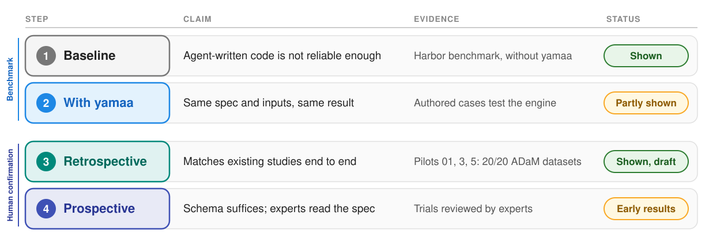

## Pilot 7: whole-study evaluation

Benchmarks test one derivation;
[R Consortium Pilot 7](https://rconsortium.github.io/submissions-pilot7-synthetic-data/)
tests whole studies.

:::: {.columns}
::: {.column width="48%"}
::: {.big-number}
20 / 20
:::
::: {.metric-label}
ADaM datasets match the official submissions
:::
:::

::: {.column width="48%"}
::: {.big-number}
13.7M
:::
::: {.metric-label}
cells matched
:::
:::
::::

::: {.roles}
| Study | Data flow | Result |
| --- | --- | --- |
| **CDISC Pilot 01** | SDTM -> ADaM | 10 / 10 ADaM datasets match |
| **Submission Pilots 3 and 5** | SDTM -> ADaM | 5 / 5 ADaM datasets match in each |
| **CAR-T (OpenClinica sample)** | ODM -> SDTM -> ADaM | No reference; people review |
| **KN189, KN564 (synthetic)** | ODM -> SDTM -> ADaM | No reference; people review |
:::

Matching data is not the end: agents flag where Define-XML and the data
disagree, and people decide each finding.

# Case study: reviewing benchmarks {background-color="#385898"}

::: {.section-brief}
**You will:** review a yamaa benchmark and an R Consortium Pilot 7 finding, and
see how people finalize each one.
:::

## Two benchmarks to review

An AI-assisted draft is not truth until experts who do the work confirm it.

| | yamaa benchmark | R Consortium Pilot 7 |
| --- | --- | --- |
| **Scope** | One derivation, small input | Full study |
| **Reviewers check** | Task, inputs, expected output, three AI concerns | Each AI-reported Define-XML vs. ADaM discrepancy |
| **Improvement by** | Addressing reviewer feedbacks | Fix findings confirmed by reviewers |
| **Finalized when** | Two reviewers agreed | Specification and deriviation consistency achieved |
| **Review guide** | [Benchmark review](https://elong0527.github.io/yamaa/benchmark/review/) | [Pilot 7 review guide](https://rconsortium.github.io/submissions-pilot7-synthetic-data/review/) |

## Reviewing a yamaa benchmark

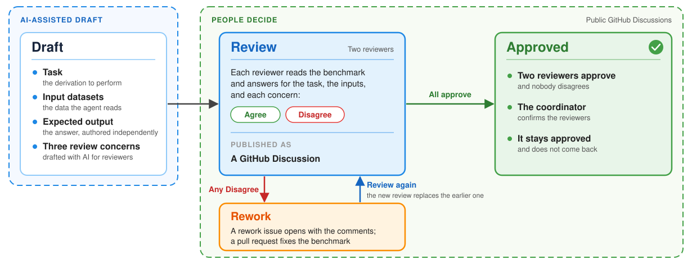

## Pilot 7: people decide on AI findings

Agents compare Define-XML with the reproduced yamaa specification and the ADaM
data; people decide each finding.

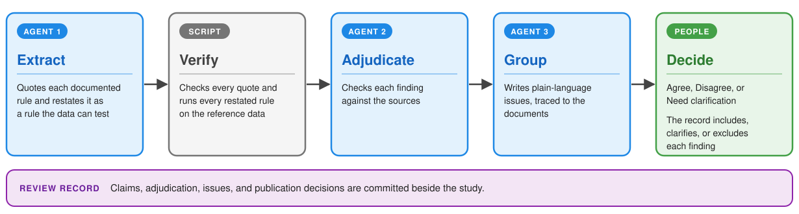

## Takeaways

- **Define the AI-first workflow** with a clear input and output for every
  step.
- **Plain text first, deterministic first:** keep artifacts inspectable, and
  let tested tools, not the model, produce the results.
- **Establish a human baseline with benchmarks** before you trust an agent's
  output.

## Keep going after the course

- **Review a benchmark** in five minutes:
  [Start reviewing](https://elong0527.github.io/yamaa/benchmark/review/next/).
  Each review helps finalize the truth that agents are measured against.
- **Join R Consortium Pilot 7:** the
  [working group](https://rconsortium.github.io/submissions-wg/pilot7.html)
  and its
  [review guide](https://rconsortium.github.io/submissions-pilot7-synthetic-data/review/).
- **Explore a full study:** the
  [Pilot 7 synthetic data](https://github.com/RConsortium/submissions-pilot7-synthetic-data)
  holds complete SDTM and ADaM packages; the Codespace in the appendix has
  yamaa and the agents ready.
- **Before adopting an agent,** run it on the public benchmarks through
  [Harbor Hub](https://hub.harborframework.com/jobs?access=all&owner_org=yamaa)
  or on benchmarks of your own.

## References

- **yamaa:** [repository](https://github.com/elong0527/yamaa),
  [documentation](https://elong0527.github.io/yamaa/),
  [R, Python, and command-line API](https://elong0527.github.io/yamaa/articles/api/),
  and [benchmarks](https://elong0527.github.io/yamaa/benchmark/).
- **Harbor:** the [framework](https://github.com/harbor-framework/harbor) and
  [Harbor Hub](https://hub.harborframework.com/jobs?access=all&owner_org=yamaa).
- **R Consortium:** the
  [Submissions Working Group](https://rconsortium.github.io/submissions-wg/)
  and the
  [Pilot 7 synthetic data](https://rconsortium.github.io/submissions-pilot7-synthetic-data/).
- **FDA:** the
  [draft guidance on AI to support regulatory decision-making](https://www.fda.gov/regulatory-information/search-fda-guidance-documents/considerations-use-artificial-intelligence-support-regulatory-decision-making-drug-and-biological)
  and the CDRH [discussion paper](https://www.fda.gov/media/194242/download)
  on generative AI-enabled devices.
- **These slides:**
  <https://ai4csr.org/slides/asa-boston-2026-11-12/>

## Questions {background-color="#385898" .center}

::: {.section-brief}
Thank you. Post your questions in the group chat, or open an issue on
[github.com/elong0527/yamaa](https://github.com/elong0527/yamaa/issues).
:::

# Appendix {background-color="#385898"}

## Preparation

This workshop assumes familiarity with the clinical development lifecycle
and CDISC standards, as well as R programming experience.

A preconfigured GitHub Codespace is ready for the workshop:

- [{.codespaces-badge}](https://codespaces.new/elong0527/yamaa)
  + R and common R packages for data standardization.
  + OpenCode, Claude Code, and Codex.

- Start [OpenCode](https://opencode.ai/).
  + Run `/connect` to connect to [OpenCode Go](https://opencode.ai/console/go)
    with the provided API key.
  + Run `/models` to select `opencode-go/muse-spark-1.3-contributor`.
  + Or sign in to the preinstalled [Claude Code](https://code.claude.com/docs/en/quickstart),
    [Codex](https://learn.chatgpt.com/docs/codex/cli), or [Muse code](https://dev.meta.ai/)
    with your own account.

## Verify the GitHub Codespace {.compact}

:::: {.columns}

::: {.column width="50%"}
**Step 1. Check R and yamaa**

Open the Codespace, start R from the terminal, and run:

```r
library(yamaa)
yamaa_selftest()
```

::: {.expect}
**Expect:** the first line reads `yamaa selftest: succeeded`.
:::
:::

::: {.column width="50%"}
**Step 2. Check an AI agent**

Start an agent in the terminal: `opencode`, `claude`, `codex`, or `muse`.
Then ask:

::: {.prompt}
Explain ODM XML and its relationship to EDC systems and CRFs.
:::

::: {.expect}
**Expect:** the agent answers in the terminal.
:::
:::

::::


## yamaa: four components

| Component | Purpose | Links |
| --- | --- | --- |
| Schema | Declares the vocabulary of the specification. | [Repository](https://github.com/elong0527/yamaa/tree/main/yaml) / [Introduction](https://elong0527.github.io/yamaa/articles/schema-intro/) |
| Rules | Defines the meaning of each specification. | [Repository](https://github.com/elong0527/yamaa/tree/main/rules) / [Rules](https://elong0527.github.io/yamaa/articles/rules/) |
| Engine | Runs specifications in Python, R and CLI consistently following the rules. | [Python](https://github.com/elong0527/yamaa/tree/main/python) / [R](https://github.com/elong0527/yamaa/tree/main/R/yamaa) / [CLI](https://github.com/elong0527/yamaa/tree/main/rust/crates/yamaa-cli) |
| Benchmark | Provides runnable specification examples. | [Repository](https://github.com/elong0527/yamaa/tree/main/benchmarks) / [Dashboards](https://elong0527.github.io/yamaa/benchmark/) |


## Open source has reached the regulators

- The R Consortium Submissions Working Group engages directly with the FDA.
  + Seven pilots demonstrate best practices for FDA submissions using R.

:::::::: {.hex-grid}
::: {.hex-item}
[](https://rconsortium.github.io/submissions-wg/pilot1.html)

**Pilot 1**

2021 -- 2022
:::

::: {.hex-item}
[](https://rconsortium.github.io/submissions-wg/pilot2.html)

**Pilot 2**

2022 -- 2024
:::

::: {.hex-item}
[](https://rconsortium.github.io/submissions-wg/pilot3.html)

**Pilot 3**

2023 -- 2024
:::

::: {.hex-item}
[](https://rconsortium.github.io/submissions-wg/pilot4.html)

**Pilot 4a**

2024 -- 2025
:::

::: {.hex-item}
[](https://rconsortium.github.io/submissions-wg/pilot4.html)

**Pilot 4b**

2024 -- 2025
:::

::: {.hex-item}
[](https://rconsortium.github.io/submissions-pilot5-website/)

**Pilot 5**

2025 -- 2026
:::

::: {.hex-item}
[](https://rconsortium.github.io/submissions-wg/pilot6.html)

**Pilot 6**

2026 -- ongoing
:::

::: {.hex-item}
[](https://rconsortium.github.io/submissions-wg/pilot7.html)

**Pilot 7**

2026 -- ongoing
:::
::::::::

## R Consortium Pilot 7: full studies

- Builds a publicly available, agentic workflow for data standardization.
  + <https://rconsortium.github.io/submissions-pilot7-synthetic-data/>
- CDISC pilots (SDTM -> ADaM)
  + CDISCPILOT01 and R Consortium Submission Pilots 3 and 5.
- OpenClinica real sample data (ODM -> SDTM -> ADaM)
  + Real sample data that tests the full data journey.
- Synthetic studies (ODM -> SDTM -> ADaM)
  + ODM XML simulated from real clinical studies.


## Objective: name the decision first

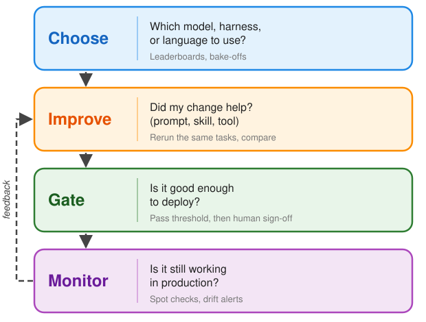


## Intervention: the system you deploy

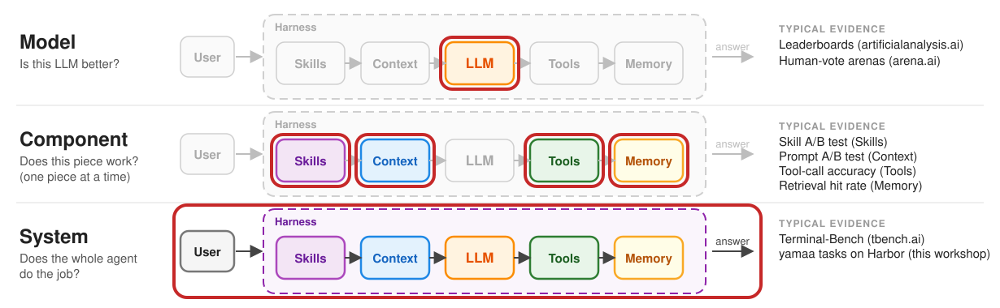

**Evaluate what you deploy: the whole system.** A trial tests the drug product
as patients take it, not the molecule alone; likewise, a top leaderboard model
does not guarantee a working workflow.

## Endpoint: how each task is scored

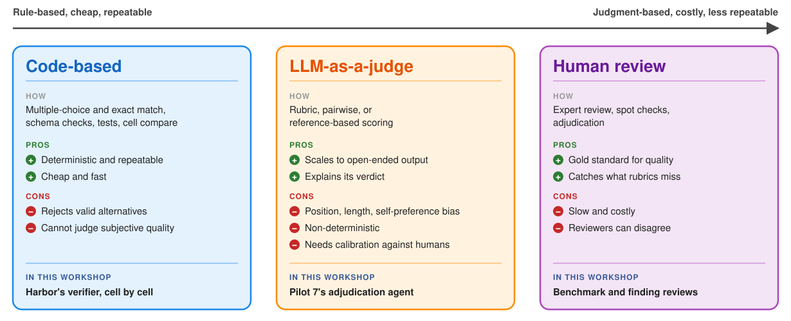

**Mix them:** code where the truth is checkable, an LLM judge to scale the
rest, and people to calibrate and sign off.
