# Welcome {background-color="#385898"}

## Outline

The course runs about three hours, with a break after Parts 1 and 2.

| | Topic | Instructor |
| ----- | ------------------------------- | ---------- |
| Part 1 | **AI agents and AI-first workflow** | Yilong |
| Part 1 | **Agentic CDISC data standardization** | Yilong |
| Break | | |
| Part 2 | **Giving agents the right context for domain-specific workflows** | Eric |
| Break | | |
| Part 3 | **Benchmarks** | Yilong |
| Part 3 | **Case study: reviewing benchmarks** | Eric and Yilong |

## Disclaimer

The views and opinions expressed in this presentation are those of the
individual presenters. They do not represent those of their affiliated
organizations or institutions.

## Training objectives

This workshop aims to help you:

* Understand the building blocks of an agentic workflow, with CDISC data
  standardization as one example.
* Recognize where an AI agent's performance may be improved.
* Get started with creating and reviewing benchmarks that assess AI agents.

::: callout-note
Toolchains, processes, and formats differ across organizations.
This workshop shows one possible approach, not the only one.
:::

## Resources

* During the workshop, we will use three projects:
  - [yamaa](https://github.com/elong0527/yamaa): tools and benchmarks for CDISC data standardization.
  - [R Consortium Pilot 7 project](https://github.com/RConsortium/submissions-pilot7-synthetic-data): synthetic trials that demonstrate CDISC data standardization.
  - [ai4csr](https://ai4csr.org/): the book and slides for this short course.

* Post your questions in the group chat.

# AI agents {background-color="#385898"}

::: {.section-brief}
**You will:** name the parts of an AI agent and say what each one can and
cannot do.
:::

## Example: arena.ai

[Try it at arena.ai/agent](https://arena.ai/agent){.try-it}

:::: {.columns}

::: {.column width="50%"}
::: {.prompt}
Use the Pilot 5 ADSL dataset to generate a baseline characteristics table
using R and gtsummary.

Data: <https://github.com/RConsortium/submissions-pilot7-synthetic-data/tree/main/submission-pilot5/data/adam>
:::
:::

::: {.column width="50%"}
To finish, the agent has to:

1. Find `adsl.parquet` in the folder.
2. Read it in R.
3. Pick the population, arms, and grouping variables.
4. Build the table with gtsummary.
5. Return the table and its code.
:::

::::

**What to check:** the prompt never names the population, variables, or
statistics, so the agent has to guess them. Do they match your table shell?

## Example: Muse

[Try it at muse.ai](https://muse.ai){.try-it}

:::: {.columns}

::: {.column width="60%"}
Muse is a personal agent from Meta. "Give Muse a goal or task and it handles
the rest": sort email, book a dinner, or fill out a form.

Muse also helps me maintain open-source projects in the background:

- Identify project gaps from published PHUSE papers.
- Bring new benchmark ideas for CDISC standardization.
:::

::: {.column width="40%"}

:::

::::

## What is an AI agent?

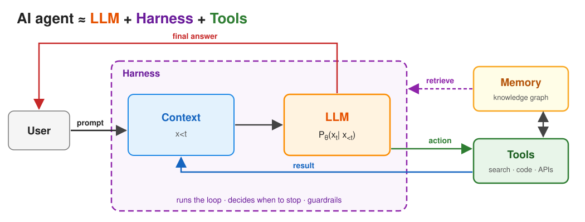

## What is a large language model?

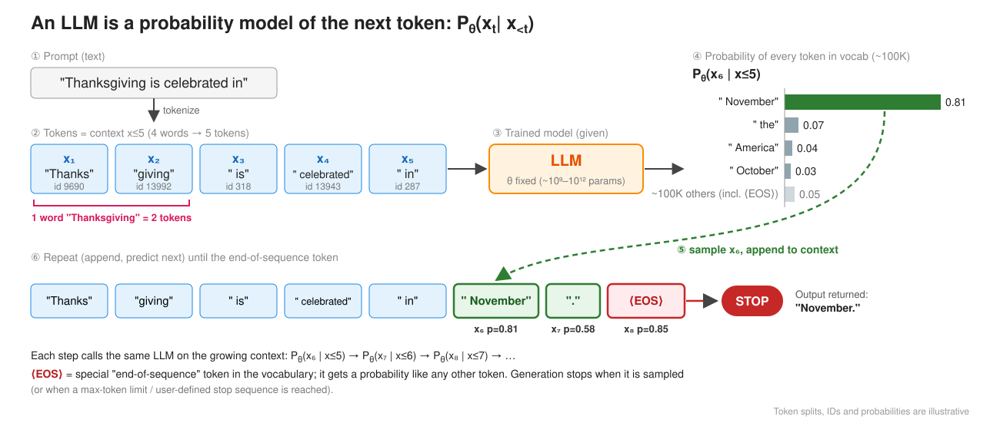

An LLM only predicts the next token from its context. It cannot open a file or
run code: a harness does that and puts the results back into the context.

## What is a harness?

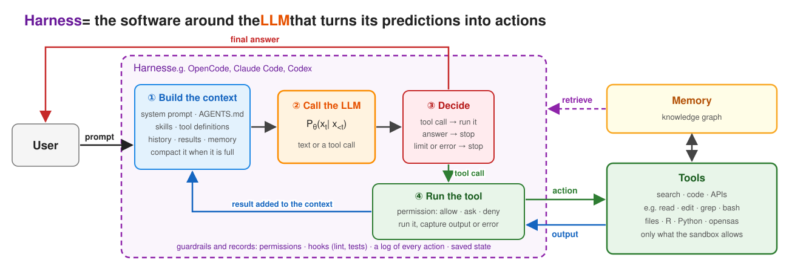

> The LLM is like the CPU; the harness is like the operating system.

## Reference: Agent vocabulary

::: {.glossary}
| Term | Meaning |
| ----- | -------------------- |
| Prompt | The request, with every rule you wrote into it. |
| Token | A word or part of a word: the unit a model reads and writes. |
| Context | The ordered tokens the model sees in one call: prompt, files read, tool results. |
| LLM | Predicts the next token from the context. |
| Harness | Builds the context, calls the model, runs tools, logs each step: OpenCode. |
| Tool | A program the harness runs for the model: read a file, run R. |
| Skill | Task instructions the harness loads: the agent's SOP. |
| Agent | LLM, harness, and tools, looping until the task is done. |
:::

# AI-first workflow {background-color="#385898"}

::: {.section-brief}
**You will:** design an AI-first workflow and the principles that keep it
trustworthy.
:::

## A mental game

:::: {.columns}

::: {.column width="55%"}
::: {.scenario}
**Shaping an AI-Native Biometrics Group from Day 0**

**What would you do?**

You have been hired by the CMO to build a biometrics group.
:::
:::

::: {.column width="45%"}
#### Blank Slate

- No legacy systems to migrate.
- No "we've always done it this way" culture.

#### Rare Opportunity

- Build an AI-native group from scratch.
- Skip the "digital transformation" pain.
:::

::::

> *Let's brainstorm the strategy for a small- to midsize biopharma company.*

## What is AI-native?

> AI-native is an organization whose workflows are mostly AI-first and
> connected through shared, inspectable artifacts.

::: {.ai-levels}
| AI adoption | AI-first | AI-native |
| --- | --- | --- |
| **AI added to existing work** | **AI is the default starting point** | **AI is a core collaborator** |
| AI helps with isolated tasks; the workflow does not change. | AI starts and executes the tasks of some workflows. | AI-human collaboration is designed across workflows. |
| *Example: ChatGPT drafts an email or summarizes a document.* | *Example: every analysis starts with a prompt to an AI agent.* | *Example: AI agents run CDISC data standardization end to end.* |
:::

> **AI-native is a mindset, not a tool:** every team member orchestrates AI
> agents, handles the exceptions, and keeps improving the system.

## Design an AI-first workflow

> Let's design an AI-first workflow for CDISC data standardization.

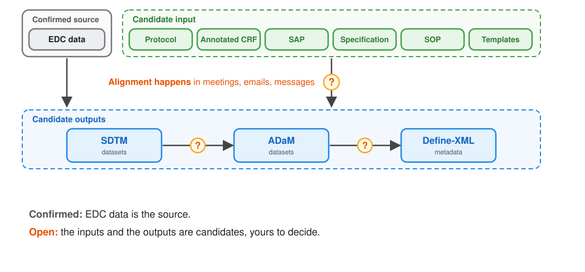

## Brainstorm: where to start building

You will build an AI agent for this workflow. **Where do you start, and why?**

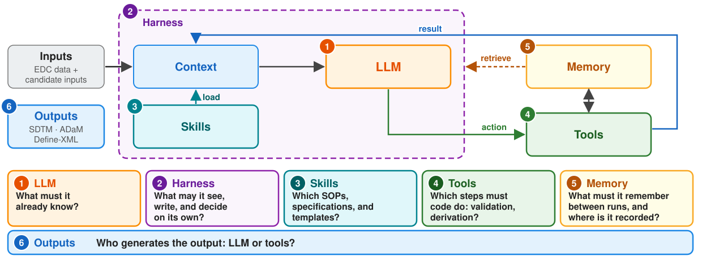

## Opinionated proposal

- As a Biometrics organization, focus on defining the workflow.
- Leverage internal and external AI infrastructure, with proper skills and tools.

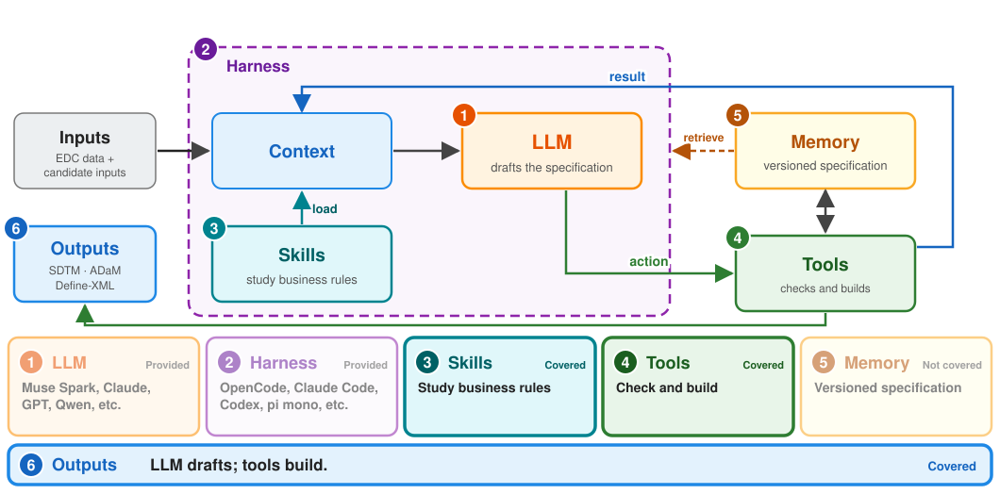

## Agentic workflow design principles

> **Primary goal: trustworthy assistance.** The agent's work can be inspected,
> repeated, challenged, and reviewed.

::: {.principles}
| Principles | Goal |
| -------------------------- | ------------ |
| Plain text first | Inspectable artifacts |
| Single source of truth | Explicit state |
| Deterministic first | Tools and evidence |
| Agent-specific identity | Attributable actions |
:::

For CDISC data standardization, we recommend:

- Do not use the annotated CRF as an input; generate it as an output.
- Do not use a specification in Excel, Word, or PDF as an input; use a plain-text specification.

# Agentic CDISC data standardization {background-color="#385898"}

::: {.section-brief}
**You will:** see why agents disagree on CDISC derivations and how a reviewed,
plain-text specification removes the guesswork.
:::

## Contributors {.center}

::: {.center-body-left}
- **Peng Zhang** CIMS Global
- **Bingjun Wang** Genentech
- **Ming-chun Chen** Summit Therapeutics
- **Jingwei Xiong** Merck & Co., Inc.
- **Yilong Zhang** BBSW AI Committee
:::

## Motivation

* Two AI agents derive the same analysis dataset from the same specification
  ([example from arena.ai](https://arena.ai/c/01a18ded-d0db-7852-b6e9-1528ddf4eb42)).
* Both report success, but their code and outputs may differ.
* A reviewer must resolve every difference before signing off.

From an FDA [warning letter](https://www.fda.gov/inspections-compliance-enforcement-and-criminal-investigations/warning-letters/purolea-cosmetics-lab-722591-04022026).

> "you must review the AI-generated documents to ensure they were accurate and actually compliant..."

## One root cause

* The user prompt leaves business rules implicit, so agents must infer them.
* Business rules can differ from language defaults:
  * [R](https://stat.ethz.ch/R-manual/R-devel/library/base/html/Round.html) and [Python](https://docs.python.org/3/library/functions.html#round) round ties to even.
  * [SAS](https://documentation.sas.com/api/docsets/lrcon/9.4/content/lrcon.pdf) compares missing numeric values as lower than non-missing values.

## Evidence: prompt completeness decides success

| Prompt tier | Python | R | opensas |
| --- | --- | --- | --- |
| Full | 99.3% (133/134) | 98.5% (132/134) | 86.6% (116/134) |
| Conventions | 35.8% (48/134) | 33.6% (45/134) | 34.3% (46/134) |
| Brief | 18.7% (25/134) | 17.9% (24/134) | 15.7% (21/134) |

**Same 134 tasks, same agent; only the prompt changed.** Writing the business
rules into the prompt lifts the pass rate from under 20% to over 85%.

::: {style="font-size: 75%;"}
opensas: <https://github.com/kirha-ai/opensas><br>
Agent: opencode 1.18.33. Model: opencode-go/muse-spark-1.3-contributor, 1 attempt, Oct 12 2026
:::

## Mean arterial pressure: three prompts {.map-prompts}

::: {.map-shared}
**Shared Prompt:**

- create an output `ADVS` from the provided input `ADVS`, following CDISC ADaM standards; one record per subject, visit, and parameter.
- `STUDYID, USUBJID, PARAMCD, PARAM, AVAL, VISIT, DTYPE`
- read from `/app/input`; write `/app/output/advs.csv`.
:::

::: {.map-comparison}
| Rule in the prompt | Full - **passes** | Conventions - **passes** | Brief - **fails** |
| --- | --- | --- | --- |
| MAP identifiers | `PARAMCD = "MAP"`<br>`PARAM = "Mean Arterial Pressure (mmHg)"` | Same MAP identifiers | Not stated |
| Records to add | One per subject and visit with both `SYSBP` and `DIABP`; none when either is absent or missing. | Not stated | Not stated |
| `AVAL` | Two-thirds `DIABP` plus one-third `SYSBP`;<br>not rounded. | Not rounded;<br>formula not stated. | Not stated |
| `DTYPE`<br>(sponsor convention) | Added record: `CALCULATION`.<br>Collected records: no value. | `CALCULATION` or no value;<br>assignment not stated. | Not stated |
:::
::: {.map-takeaway}
**Brief omits both the MAP formula and the rule for adding a record.**<br>
The ADaM IG uses `DTYPE` for records derived differently within a parameter; setting it on a whole derived parameter is a sponsor rule the agent cannot infer.<br>
`SYSBP` = systolic blood pressure; `DIABP` = diastolic blood pressure.<br>
<https://elong0527.github.io/yamaa/benchmark/adam-advs-map.html>
:::

## Goal

- Reduce human review effort.
- Leverage organization templates.
- Capture business rules that AI agents can apply.
- Move human-AI collaboration to the planning stage.

## yamaa: collaboration at the planning stage

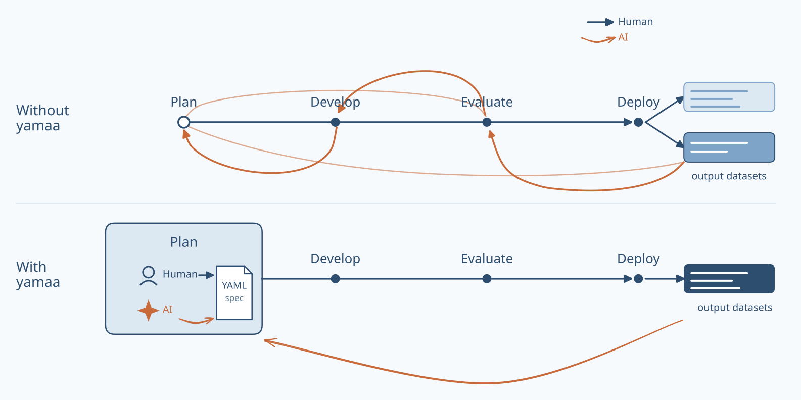

Human and AI review the specification during planning; the engine executes the agreed rules.

## yamaa: YAML specification example

::: {.spec-code}
```yaml
yamaa: "1.0"
type: spec
model: ADaM
domain: ADSL
keys: [STUDYID, USUBJID]
input:
  SOURCE:
    path: input/adsl.csv
    types: {HEIGHTCM: float, WEIGHTKG: float}

output:
  path: adsl.csv
  columns: [STUDYID, USUBJID, BMI]

columns:
  - {name: STUDYID, type: str, label: Study Identifier, derivation: SOURCE.STUDYID}
  - {name: USUBJID, type: str, label: Unique Subject Identifier, derivation: SOURCE.USUBJID}
  - {name: HEIGHTCM, type: float, label: Height (cm), derivation: SOURCE.HEIGHTCM}
  - {name: WEIGHTKG, type: float, label: Weight (kg), derivation: SOURCE.WEIGHTKG}
  - name: BMI
    type: float
    label: Body Mass Index (kg/m2)
    derivation: "WEIGHTKG / POWER(NULLIF(HEIGHTCM, 0) / 100, 2)"
```
:::

## yamaa: core principle

> A yamaa specification has exactly one execution. Where it would have two,
> yamaa fails instead of choosing.

::: {.formula}
*`output_dataset = derive(input_datasets, spec)`*
:::

The specification is a contract between people and AI agents:

- **spec:** written in the closed vocabulary of the schema.
- **derive:** applies each business rule with one defined meaning.

## yamaa: where the uncertainty lives

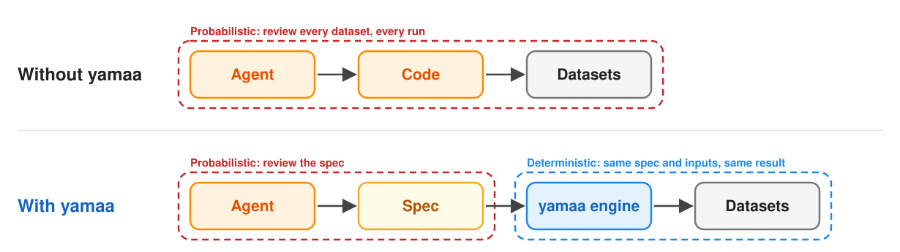

The AI agent is probabilistic, so people review the specification. The engine
that executes it is deterministic: the same specification and inputs give the
same datasets.

## yamaa: inheritance

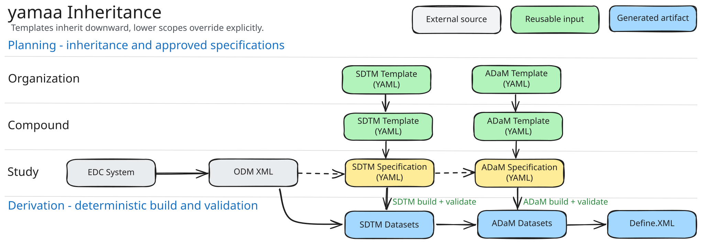

Inheritance reduces duplication while keeping every resolved study specification self-contained and reviewable.
([example](https://elong0527.github.io/yamaa/benchmark/schema-inheritance.html))

## Summary of the workflow

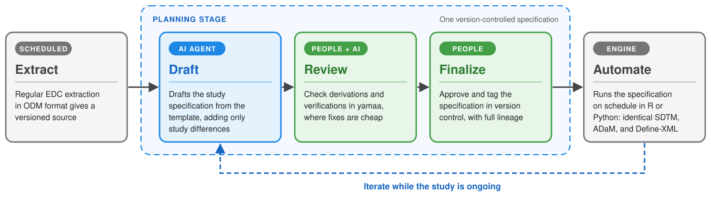

People and AI agents collaborate on one version-controlled specification at
the planning stage, while the study is ongoing.

# Giving agents the right context for domain-specific workflows {background-color="#385898"}

::: {.section-brief}
**You will:** see two ways to give an agent the right context for a
domain-specific job --- a workflow, shown with medical monitoring; and a
skill, shown with group sequential trial design.
:::

::: {.section-brief .speaker}
Eric Zhang
:::

## Topic 1: A workflow for medical monitoring

**Good agentic workflows start with a good harness**

The harness is everything around the model: structure, memory, delegation,
and checks. Build that well, and the workflow takes care of itself.

:::: {.columns}

::: {.column width="50%"}
1. **Folder structure** --- one shape per study
2. **`CLAUDE.md` / `AGENTS.md`** --- standing instructions, root + per-study, read every session
3. **Audit trail** --- three sources together: git, session log, and the platform's system log
4. **Git** --- what changed, diffable and reversible
5. **Session log** --- memory, why it changed, enforced by a hook
:::

::: {.column width="50%"}
6. **Sub-agents** --- one per task in the workflow, split context
7. **Skills** --- domain knowledge, encoded once
8. **Evaluation** --- methodological independence, humans stay accountable
9. **Worked example** --- the daily dashboard workflow, step by step
:::

::::

## One folder per study, on a shared AWS platform

:::: {.columns}

::: {.column width="55%"}
```text
AWS Cloud                     conceptual illustration
|-- Compute (isolated per user, autoscaled)
|   |-- Alice's session + AI    own container, own limits
|   `-- Bob's session + AI      own container, own limits
|
|-- IAM + POSIX / EFS access points
|   |-- home/<user>/              read-write: owner only
|   |-- shared/.../development/   read-write: study team
|   `-- shared/.../production/    read-only; write via QC gate
|
`-- Storage
    |-- EFS  shared/studies/STUDY-001/
    |   |-- development/  raw -> sdtm -> adam -> qc
    |   |-- [[ QC-reviewed promotion ]]
    |   |-- production/   adam, logs   (audit-logged)
    |   `-- git/study-code.git         central bare repo
    `-- EBS  home/
        |-- alice/STUDY-001/        personal git clone
        `-- bob/STUDY-001/          personal git clone
```
:::

::: {.column width="45%"}
- **Self-contained per study, shared by the team.** Each study still owns
  its data, scripts, and history --- now on storage sized for many users
  and many studies at once.
- **Isolated compute per user.** No shared box to contend for; one user's
  heavy job can't starve another's session.
- **Access-controlled, not just folder-shaped.** IAM + POSIX gates who can
  read/write home, development, and production separately.
- **Production is a gate, not a folder an agent writes to.** Promotion out
  of development is a reviewed QC step.
:::

::::

> Physical isolation plus access control is what makes context isolation
> reliable at platform scale: an agent in Alice's session cannot reach
> Bob's data, or write into production directly.

## Initialize with one prompt

:::: {.columns}

::: {.column width="55%"}
::: {.prompt}
initialize this folder

(in Claude Code --- or the built-in `/init` command)
:::

**Result:** `CLAUDE.md` --- what the workspace is, how it's laid out, and the
rules every session must follow.
:::

::: {.column width="45%"}
- **Standing instructions.** Read at the start of every session --- no
  re-explaining.
- **A draft, then a contract.** The prompt drafts it from what's already in
  the folder; you edit it into your rules.
- **Grows with decisions.** Layout, data rules, required workflows --- every
  decision worth keeping gets written in.
- **Root + per-study.** A short root file for workspace-wide rules; each
  study folder gets its own for that study's quirks, auto-loaded only
  there.
:::

::::

> Chat forgets. `CLAUDE.md` doesn't.

## The audit trail: three layers

| Layer | Answers | Written by |
| --- | --- | --- |
| **Git** | What changed? | The agent, one commit per change |
| **Session log** | Why did it change? | The agent, enforced by a hook |
| **Platform system log** | Who was in the system, and when? | The platform itself (e.g. Workbench), independent of the agent |

> No single layer has to be trusted alone: what the agent changed, why it
> changed it, and who could have touched the system at all --- from three
> different sources.

The platform's own system log needs no building: logins and sessions are
already recorded by the infrastructure (e.g. Posit Workbench), independent
of anything the agent does. Git and the session log are what you build on
top of it.

## Git: what changed

:::: {.columns}

::: {.column width="55%"}
```text
$ git log --oneline -5
a1b2c3d fix: detect the newest snapshot instead of a hardcoded default
9f8e7d6 feat: add a PP record to ADVS per the study SAP
7c6d5e4 fix: round AVAL per protocol convention, not language default
3b2a1f0 docs: record the baseline-derivation rule in CLAUDE.md
0e9d8c7 chore: initialize STUDY-003 from the workspace template
```
:::

::: {.column width="45%"}
- **Every change is a commit.** Code, `CLAUDE.md`, skills, specs --- one
  history, diffable and reversible.
- **Same discipline as a human PR.** The agent stages named files and
  writes a message; a human's say-so is still required for anything
  destructive --- force-push, `reset --hard`, skipping hooks.
- **One source of truth.** The same principle behind yamaa's
  version-controlled specification applies to the whole workspace.
:::

::::

> If a change isn't committed, it isn't real yet.

## Give the agent a memory --- a log file

:::: {.columns}

::: {.column width="55%"}
```text
STUDY-003/docs/session_log.md          append-only
...
## 2026-11-09
- Snapshot mislabel: the "Nov 9" refresh read the Nov 3 cut.
  Root cause: hardcoded snapshot default; refresh passed no argument.
  Fixed: newest snapshot detected and passed explicitly.
- Rebuilt on the correct snapshot; flags 43 -> 50 (3 resolved, 4 new).
- Independent validation (10th pass): PASS -- zero errors.
- OPEN: access for the second reviewer.
...
```
:::

::: {.column width="45%"}
- **Two layers.** A hook auto-lists every file touched; the agent writes
  the why --- decisions, fixes, open questions.
- **Enforced.** After code changes, the hook blocks the session from ending
  until the entry is written.
- **Memory across sessions.** The next session --- or a colleague --- reads
  what happened and why.
:::

::::

> Hooks are your own scripts, run automatically on session events: build
> your own guardrails. Anything you want the agent to *always* do, make it
> a hook, not a reminder.

**If it isn't written down, the next session doesn't know it.**

## Sub-agents: one per task in the workflow

:::: {.columns}

::: {.column width="65%"}
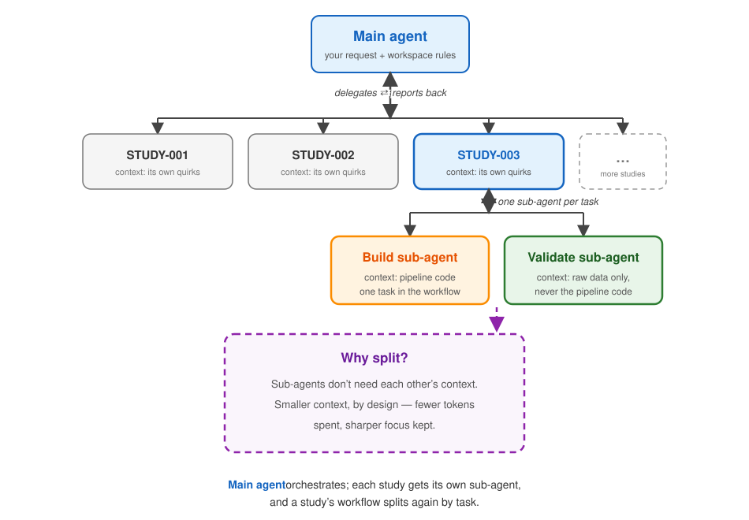{width="100%"}
:::

::: {.column width="35%"}
- **You don't hand-write these.** Say "create a sub-agent for the
  STUDY-003 dashboard" and the main agent drafts it; you review and
  refine it.
- **Context never carries back up.** The main thread gets only the final
  report --- one validation run recomputed everything from raw data across
  roughly 270,000 tokens; the main thread received a two-page summary.
- **Validation gets deliberately less context than development** --- raw
  data only, never the pipeline code. That independence is what makes a
  PASS meaningful.
:::

::::

## Encode domain knowledge as skills

:::: {.columns}

::: {.column width="55%"}
```text
~/.claude/skills/
|-- medical-monitoring-report/   the dashboard playbook
|   |-- SKILL.md                 when it triggers, the method
|   `-- references/              architecture, interactivity, validation
|-- recist-confirmation/         RECIST 1.1 confirmed-response rules
|-- group-sequential-design/     trial-design Q&A workflow
|-- gsdose/                      seamless phase 2/3 dose-selection designs
`-- km-digitizer/                digitize published KM curves
```
:::

::: {.column width="45%"}
- **What is a skill?** A playbook the agent loads whenever the task
  matches: triggers, method, references, scripts. Written once by the
  expert; followed every session after.
- **Example: ADaM derivation order.** A skill encodes the order: build the
  intermediate `ADINTDT` before `ADTTE`, which depends on it --- not the
  reverse.
- **Claude helps you write them.** A built-in skill-creator skill
  interviews you, drafts the `SKILL.md`, and tests it.
:::

::::

> A prompt asks for an outcome. A skill defines how it's always done.

## Evaluation: methodological independence

Evaluation runs on the same harness you just built:

:::: {.columns}

::: {.column width="33%"}
**A separate evaluator**

Uses sub-agents. A fresh sub-agent that never built the thing --- raw data
only, never the pipeline code. It recomputes; it doesn't re-read.
:::

::: {.column width="33%"}
**A validation skill**

Uses skills. The same checks, every time: recompute every number from
raw, check cross-output consistency, fix before shipping.
:::

::: {.column width="34%"}
**Failure patterns on file**

Uses the audit trail. Past failures live in the session log; every new
evaluation checks for the mistakes already made once.
:::

::::

> The agent evaluates; a human signs off. Nothing ships on an agent's
> PASS alone --- we own what ships.

## Worked example: the daily dashboard workflow {.compact}

::: {.ai-native}
::: {.ai-native-label}
AI-native
:::
::: {.skill-label}
skill: medical-monitoring-report
:::

::: {.flow .flow-5}
::: {.flow-step .fragment}
Cron
[scheduled trigger]{.small}
:::
::: {.flow-step .build .fragment}
Extract &#129302;&#128736;
[the day's EDC snapshot]{.small}
:::
::: {.flow-step .build .fragment}
Build &#129302;&#128736;
[pipeline + lineage graph]{.small}
[skill ref: architecture]{.tag}
[skill: RECIST 1.1]{.tag}
:::
::: {.flow-step .build .fragment}
Assemble &#129302;&#128736;
[interactive HTML]{.small}
:::
::: {.flow-step .build .fragment}
Summary &#129302;&#128736;
[updates + data issues]{.small}
:::
:::

::: {.flow .flow-5}
::: {.flow-step .validate .fragment}
Validate &#129302;&#128269;
[recompute from raw]{.small}
[skill ref: validation]{.tag}
:::
::: {.flow-step .adjudicate .fragment}
Adjudicate &#129302;&#9878;&#65039;
[resolve flagged items]{.small}
[skill ref: validation]{.tag}
:::
::: {.flow-step .eval .fragment}
Eval &#129302;&#127919;
[vs. benchmark cases]{.small}
[miss &#8594; loop back]{.tag}
:::
::: {.flow-step .fragment}
Publish &#129302;
[one stable URL]{.small}
:::
::: {.flow-step .fragment}
Notify &#129302;
[reviewers alerted]{.small}
:::
:::

::: {.feedback-loop .fragment}
&#8635; Output misses expectation &#8594; agents go back, find why, fix,
re-run: a feedback loop
:::

::: {.audit-bar .fragment}
Git + session log --- every step logged
:::
:::

::: {.human-review .fragment}
**Human review** &#128100; --- outside the AI-native loop. Sign-off required.
:::

::: {.highlight-note .fragment}
Sub-agents for Build, Validate, and Adjudicate are each guided by a skill.
:::

## Across the trial: a TFL package that matures toward lock

The daily workflow on the previous slide doesn't run once --- it repeats for
the life of the trial, giving two things in real time:

- **Real-time benefit-risk signal finding** --- a preliminary positive signal
  is tracked cycle to cycle; once it's reinforced, that's what triggers
  database lock for reporting, not a fixed calendar date.
- **Real-time TFL finalization** --- every cycle also adds to one persisting
  TFL package, so it's already mature by the time the database locks,
  instead of being assembled from scratch after.
- **The harness itself can be packaged and shared.** The AI-native harness
  you build in your working directory can naturally be packaged as a
  skill or an MCP server --- served up as a plug-in another agency can
  connect to their own AI system.

:::: {.columns}

::: {.column width="100%"}
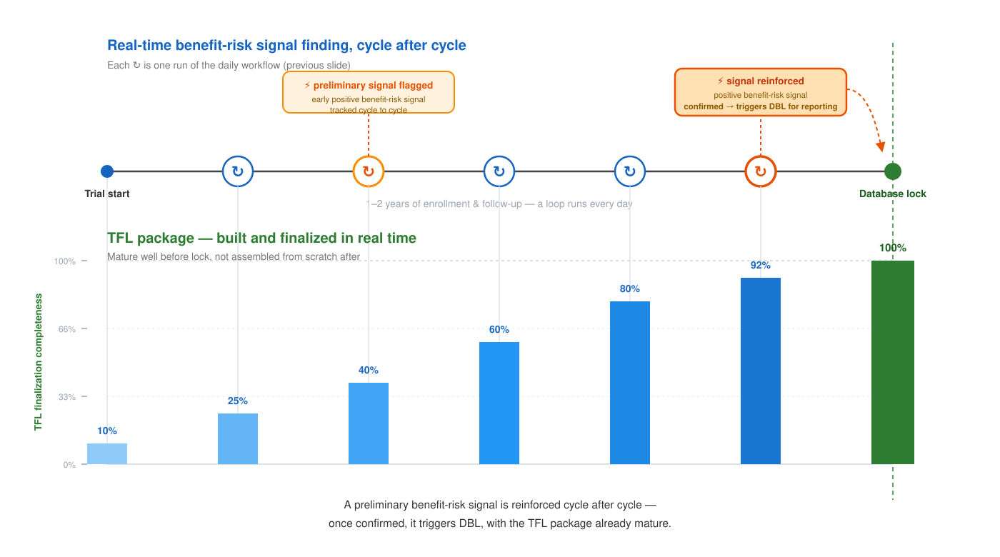{width="100%"}
:::

::::

## Recap: context for the medical monitoring workflow

- **Context guides the agent on when to use which tool.** CLAUDE.md,
  skills, and the session log don't just hand the agent tools --- they tell
  it when each one applies, so it reaches for the right one at the right
  step.
- **Context and tools are both areas domain experts can shape.** For
  example, making your organization's GitHub repo of templates, specs,
  and conventions available to the agent as a tool.
- **Skills, hook-written logs, and sub-agents sharpen that context** --- one
  skill per domain task, one log entry per hooked event, one sub-agent per
  task in the workflow --- so every step runs with just the context it needs.

## Topic 2: Building skills to bring domain knowledge into context

**A skill packages domain knowledge once --- then any agent can use it.**

Where a workflow wires together the steps of one task, a skill teaches the
agent what a domain expert already knows: the method, its assumptions, and
when it applies. This topic shows it with group sequential design for
survival trials.

- **What a skill is** --- not a tool, but a packaged how-to: methodology,
  templates, and the questions to ask before computing anything.
- **Why group sequential design** --- it's a method where domain experts
  have their own design philosophy: how to collect design inputs, and in
  what order. A skill turns that philosophy into a playbook, reflecting
  how they'd approach the design themselves.
- **Worked example** --- turning a group sequential design skill into a
  structured Q&A the agent runs with you.

## Demo: the group sequential design skill in action

::: {.demo-feature}
&#127909;

[Watch the skill run a design end to end](https://drive.google.com/file/d/1fW2CuVbp9XLnt1J6DwzsfKOtgABFPZ8t/view?usp=drive_link)

Q&A &#8594; R design script &#8594; simulation verification &#8594; Word report + reproducible R/Python scripts
:::

## A skill for group sequential design

Given a trial scenario, the [group sequential design
skill](https://github.com/RConsortium/pharma-skills/tree/main/group-sequential-design)
designs a group-sequential survival-endpoint trial --- boundaries, sample
size, and multiplicity strategy --- through a guided Q&A, verifies the
result by simulation, and delivers reproducible R/Python scripts
alongside the Word report.

:::: {.columns}

::: {.column width="50%"}
**Skill structure**

```text
group-sequential-design/
|-- SKILL.md            Q&A workflow, design steps
|-- reference.md         design rules, spending fns, alpha recycling
|-- examples.md          R code by design pattern
|-- post_design.md       timing checks, verification
`-- scripts/
    |-- compute_event_prob.R
    `-- gsd_report_template.py
```
:::

::: {.column width="50%"}
**Output structure**

```text
output/gsd_{disease}_{endpoints}_{date}/
|-- gsd_design.R
|-- gsd_results.json
|-- multiplicity_diagram.png
|-- gsd_verification.R
|-- gsd_verification_log.md
|-- gsd_report.py
`-- gsd_report.docx
```

[`.R` / `.py` scripts --- rerun to reproduce every number in the report]{.small}
:::

::::

> Loaded progressively --- each reference is only pulled into context when
> the workflow reaches that step.

## The skill's questions are my design philosophy

The skill asks its questions one at a time, in a fixed order. That order
isn't arbitrary --- it's what design inputs I need, and in what sequence,
to walk through a group sequential design the way I actually would.

:::: {.columns}

::: {.column width="100%"}
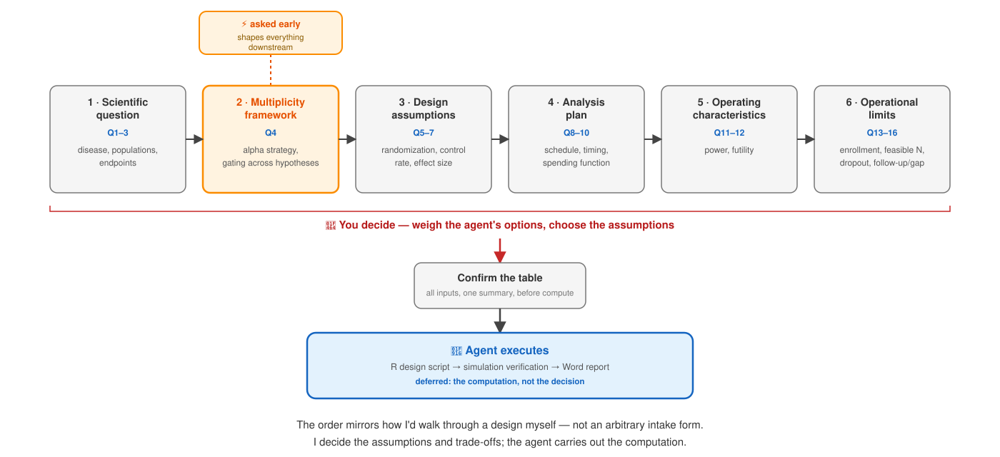{width="100%"}
:::

::::

## Benchmarking the skill: with vs. without

Any addition to an agent --- skill, tool, workflow --- should be benchmarked
with-vs-without, not assumed to help.
[21 design scenarios, skill vs. no-skill](https://github.com/RConsortium/pharma-skills/issues/146)
--- overall scorecard, best-with-skill run per scenario:

| | With skill | Without skill |
| --- | --- | --- |
| Skill wins | 16 | --- |
| Ties | 4 (#3, #21, #60, #113) | --- |
| No-skill wins | 1 (#139) | --- |
| Avg score (excl. #60, trivial) | **90%** | **62%** |

:::: {.columns}

::: {.column width="33%"}
**1 &middot; Does it add value?**

16/21 wins, 4 ties, 1 loss (#139 --- a structural gap, fix in progress).
:::

::: {.column width="33%"}
**2 &middot; How good with the skill?**

90% average vs. 62% without, at each scenario's best run.
:::

::: {.column width="34%"}
**3 &middot; Failure patterns**

P0: a four-arm, contribution-of-components design.
:::

::::

## Best practices for building a skill

:::: {.columns}

::: {.column width="50%"}
**1 &#183; Structured Q&A completes the prompt**

A skill's intake isn't boilerplate --- it's prompt engineering. Ask one
question at a time, in the order that matters, and the prompt is
complete before any computation starts.
:::

::: {.column width="50%"}
**2 &#183; Document failure patterns**

Record what's gone wrong before --- a structural gap, a wrong formula, a
missed edge case --- so the skill stops the agent from repeating a mistake
it already made once.
:::

::::

:::: {.columns}

::: {.column width="50%"}
**3 &#183; Progressive disclosure**

Don't front-load everything. Reference files load only when the workflow
reaches that step --- most of the skill never enters context at all.
:::

::: {.column width="50%"}
**4 &#183; Scripts for deterministic steps**

Anything with one right answer --- event calculations, report generation ---
belongs in a script the agent runs, not in text the agent reasons through.
:::

::::

> A skill is prompt engineering, not a prompt. Treat the intake, the
> failure modes, the context budget, and determinism as first-class
> design choices --- not afterthoughts.

## TrialDesignBench

The skill benchmark above is one case study inside a larger effort:
evaluating whether AI agents can **reproduce** or **design** clinical
trial statistical designs at all.

:::: {.columns}

::: {.column width="45%"}
- **Benchmark 1** --- reproduce a design, closed-book, from the SAP/protocol
- **Benchmark 2** --- design the same trial with no SAP, only context
  (disease, treatment, regulatory, sponsor)

[Full workflow spec](https://github.com/BBSW-org/TrialDesignBench/issues/4)
:::

::: {.column width="55%"}
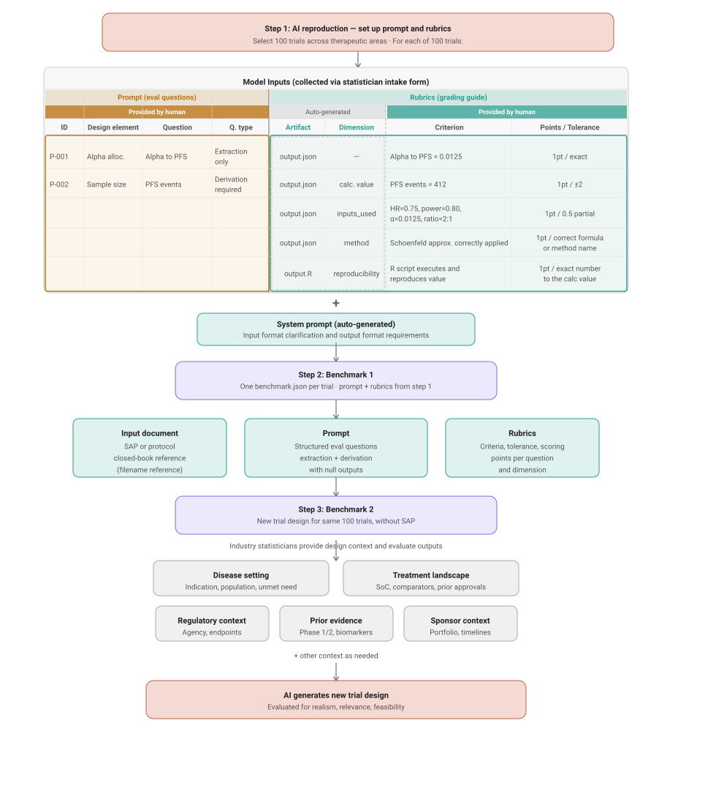{width="100%"}
:::

::::

## Building the benchmark

:::: {.columns}

::: {.column width="33%"}
**1 &middot; Intake form**

Statisticians write design questions and rubrics for a trial.

[HuggingFace Space](https://huggingface.co/spaces/trialdesignbench/tdb-intake)
:::

::: {.column width="33%"}
**2 &middot; Benchmark review**

A QA pass on submitted cases before they enter the benchmark.

[HuggingFace Space](https://huggingface.co/spaces/trialdesignbench/tdb-intake)
:::

::: {.column width="34%"}
**3 &middot; Evaluation framework**

Runs models against the benchmark, scores outputs against rubrics.

[Built on Harbor](https://bbsw-org.github.io/TrialDesignBench/)
:::

::::

## Example: question &#8594; rubric &#8594; grade

KN189 (KEYNOTE-189), P-004 --- derivation question:

> "What is the total required number of PFS events at its final analysis
> based on Lachin and Foulkes' method for the variance estimation?"

:::: {.columns}

::: {.column width="33%"}
**Inputs used**

- Target HR = 0.7 [&#10003; +1]{.pass}
- Randomization ratio 2:1 [&#10003; +1]{.pass}
:::

::: {.column width="33%"}
**Calculated value**

- PFS events at IA2 &#8776; 468 &#177;3 [&#10007; 0]{.fail}

[Model derived 472 --- out of tolerance]{.small}
:::

::: {.column width="34%"}
**Method**

- Fixed design via Lachin&#8211;Foulkes [&#10003; +2]{.pass}
- L-F uses event fractions, not allocation fractions [&#10007; 0]{.fail}
:::

::::

> Model scored **13 / 18** on this prompt.

## Where we are

:::: {.columns}

::: {.column width="30%"}
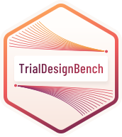{width="70%"}
:::

::: {.column width="70%"}
::: {.progress-stat}
**26 / 50 trials** toward the target benchmark size

<div class="progress-bar"><div class="progress-fill" style="width:52%"></div></div>

[toward the target benchmark size]{.progress-label}
:::

**We'd love your help.** Write a test case --- question and rubrics --- from
a protocol or SAP you know well, and help stress-test AI on real trial
design.

&#11088; [github.com/BBSW-org/TrialDesignBench](https://github.com/BBSW-org/TrialDesignBench)
:::

::::

## Recap: skills sharpen domain-specific context

- **Use skills to sharpen the domain-specific context an agent gets.** The
  group sequential design skill encoded what inputs to collect, in what
  order, and how to compute and verify the result --- my design philosophy,
  made reusable.
- **Agents like Claude Code ship a built-in skill for building skills.**
  skill-creator interviews you, drafts the `SKILL.md`, and tests it --- you
  don't start from a blank page.
- **Build a benchmark for any mission-critical skill --- don't assume it
  helps.** With-vs-without, like TrialDesignBench did here: 90% vs. 62%.

## Final thoughts

- **Build an evaluation-driven development framework.** Treat the benchmark
  like an RL environment: the cases define what "meets expectation" means,
  and development runs against them until it does.
- **Build high-quality domain-specific data.** Models get stronger on their
  own; domain knowledge is what we add. Data that captures it --- protocols,
  SAPs, rubrics, worked cases --- serves both evaluation and the context
  agents develop from.

# Benchmarks {background-color="#385898"}

::: {.section-brief}
**You will:** explore benchmark for AI evaluation
:::

## What is a benchmark?

> A benchmark is a fixed task with an independently authored answer, so an
> agent's work is measured, not judged by eye.

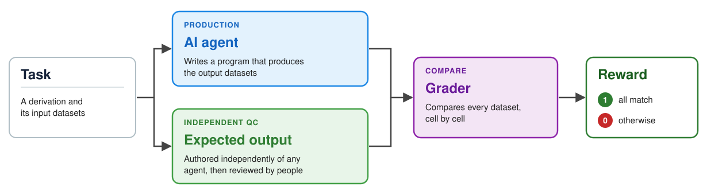

**Like double programming:** the agent is the production programmer, the
expected output is the independent QC, and the grader compares the two
datasets value by value.

## Benchmark is a trial

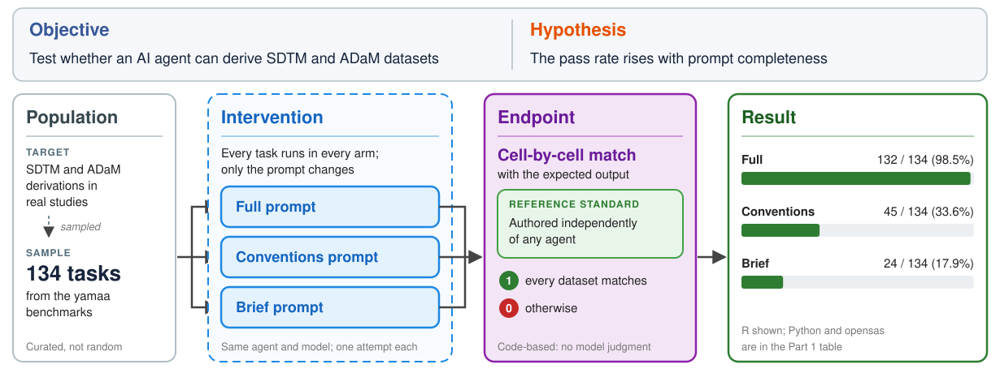

## Benchmark for SDTM and ADaM

**Goal:** test whether an AI agent can derive SDTM and ADaM datasets.

::: {.roles}
| Expectation | What each task needs | Example |
| ------ | ------------ | ------------ |
| **Relevant** | One real-study derivation | Study day in `VS`, age groups in `ADSL` |
| **Edge cases** | Inputs where two programmers could disagree | Partial dates: `2024-03` (no day), `2024` (no month) |
| **Reviewed by experts** | Experts confirm the task, inputs, and expected output | Draft, reviewed, finalized; only people finalize |
:::

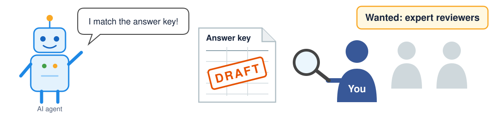{fig-align="center" width="85%"}

## yamaa benchmarks

:::: {.columns}
::: {.column width="48%"}
::: {.big-number}
~ 200
:::
::: {.metric-label}
benchmarks
:::
:::

::: {.column width="48%"}
::: {.big-number}
3
:::
::: {.metric-label}
execution interfaces (Python, R, CLI)
:::
:::
::::

- [Explore all benchmarks](https://elong0527.github.io/yamaa/benchmark/).

<iframe class="benchmark-embed r-stretch" src="https://elong0527.github.io/yamaa/benchmark/adam-adsl-age-group.html" title="Age Groups benchmark dashboard"></iframe>

Scroll inside the frame to see the specification, inputs, and expected output.

## Benchmark review progress

Each square is one benchmark; hover for its name, or select it to open the
benchmark.

::: {#review-heatmap .review-heatmap}
:::

<script src="review-heatmap.js"></script>

## Harbor: run and grade an agent

[Harbor](https://github.com/harbor-framework/harbor) runs an agent on each
benchmark task and grades the result. It produced the Part 1 prompt-tier
results; [join yamaa on Harbor Hub](https://hub.harborframework.com/invite/7chJ24hLaint4KnmK5VSTnW-Sow1D2yc)
to explore them.

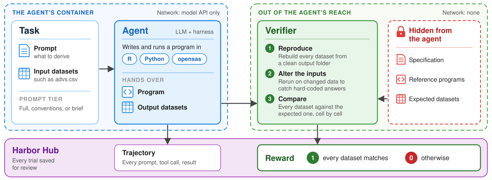

## Benchmark limitations

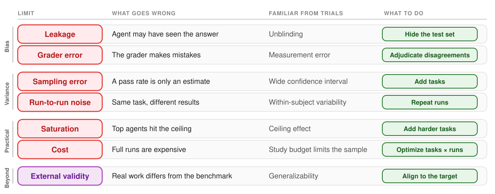

## From benchmarks to real studies

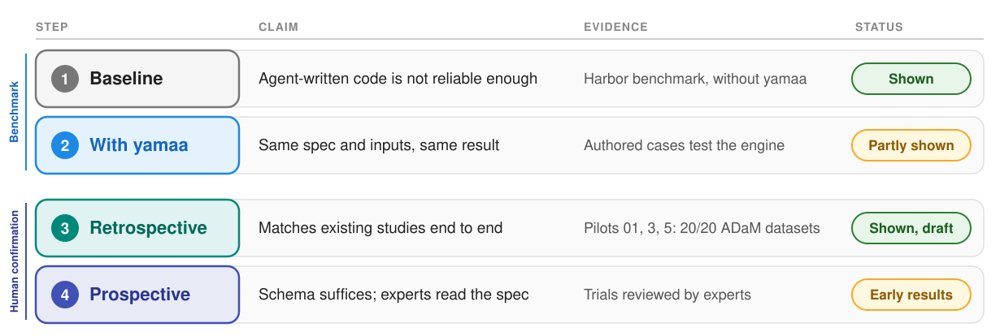

## Pilot 7: whole-study evaluation

Benchmarks test one derivation;
[R Consortium Pilot 7](https://rconsortium.github.io/submissions-pilot7-synthetic-data/)
tests whole studies.

:::: {.columns}
::: {.column width="48%"}
::: {.big-number}
20 / 20
:::
::: {.metric-label}
ADaM datasets match the official submissions
:::
:::

::: {.column width="48%"}
::: {.big-number}
13.7M
:::
::: {.metric-label}
cells matched
:::
:::
::::

::: {.roles}
| Study | Data flow | Result |
| --- | --- | --- |
| **CDISC Pilot 01** | SDTM -> ADaM | 10 / 10 ADaM datasets match |
| **Submission Pilots 3 and 5** | SDTM -> ADaM | 5 / 5 ADaM datasets match in each |
| **CAR-T (OpenClinica sample)** | ODM -> SDTM -> ADaM | No reference; people review |
| **KN189, KN564 (synthetic)** | ODM -> SDTM -> ADaM | No reference; people review |
:::

Matching data is not the end: agents flag where Define-XML and the data
disagree, and people decide each finding.

## yamaa reproduces R Submission Pilot 5 {.perf}

- [Pilot 5 dashboard](https://rconsortium.github.io/submissions-pilot7-synthetic-data/studies/submission-pilot5/#submission-pilot5/datasets/ADSL)

::: {.perf-grid}
::: {.perf-panel}
<div class="perf-title">Real size: 254 subjects</div>

<div class="perf-group">End-to-end time, 1 core</div>
<div class="perf-row yamaa"><span class="perf-label">R (yamaa)</span><span class="perf-track"><span class="perf-bar" style="width: 6.1%"></span></span><span class="perf-value">1.62 s</span></div>
<div class="perf-row"><span class="perf-label">R (admiral)</span><span class="perf-track"><span class="perf-bar" style="width: 100%"></span></span><span class="perf-value">26.45 s</span></div>
<div class="perf-group">Peak memory</div>
<div class="perf-row yamaa"><span class="perf-label">R (yamaa)</span><span class="perf-track"><span class="perf-bar" style="width: 41.1%"></span></span><span class="perf-value">0.25 GB</span></div>
<div class="perf-row"><span class="perf-label">R (admiral)</span><span class="perf-track"><span class="perf-bar" style="width: 100%"></span></span><span class="perf-value">0.60 GB</span></div>
:::

::: {.perf-panel}
<div class="perf-title">Stress test: 10x subjects (2,540)</div>

<div class="perf-group">End-to-end time, 1 core</div>
<div class="perf-row yamaa"><span class="perf-label">R (yamaa)</span><span class="perf-track"><span class="perf-bar" style="width: 6.9%"></span></span><span class="perf-value">12.62 s</span></div>
<div class="perf-row"><span class="perf-label">R (admiral)</span><span class="perf-track"><span class="perf-bar" style="width: 100%"></span></span><span class="perf-value">181.70 s</span></div>
<div class="perf-group">Peak memory</div>
<div class="perf-row yamaa"><span class="perf-label">R (yamaa)</span><span class="perf-track"><span class="perf-bar" style="width: 46.6%"></span></span><span class="perf-value">1.93 GB</span></div>
<div class="perf-row"><span class="perf-label">R (admiral)</span><span class="perf-track"><span class="perf-bar" style="width: 100%"></span></span><span class="perf-value">4.13 GB</span></div>
:::
:::

- R (yamaa) vs. original R (admiral): 14--16x faster, 2.1--2.4x less memory.

# Case study: reviewing benchmarks {background-color="#385898"}

::: {.section-brief}
**You will:** review a yamaa benchmark and an R Consortium Pilot 7 finding, and
see how people finalize each one.
:::

## Two benchmarks to review

An AI-assisted draft is not truth until experts who do the work confirm it.

| | yamaa benchmark | R Consortium Pilot 7 |
| --- | --- | --- |
| **Scope** | One derivation, small input | Full study |
| **Reviewers check** | Task, inputs, expected output, three AI concerns | Each AI-reported Define-XML vs. ADaM discrepancy |
| **Improvement by** | Address reviewer feedback | Fix findings confirmed by reviewers |
| **Finalized when** | Two reviewers agreed | Specification and derivation consistency achieved |
| **Review guide** | [Benchmark review](https://elong0527.github.io/yamaa/benchmark/review/) | [Pilot 7 review guide](https://rconsortium.github.io/submissions-pilot7-synthetic-data/review/) |

## Reviewing a yamaa benchmark

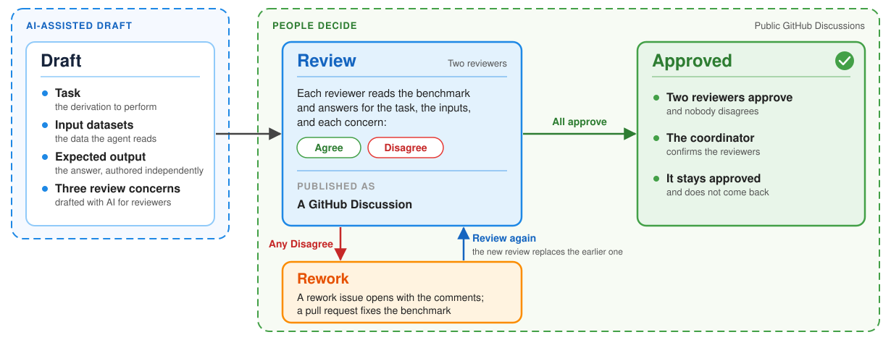

## Pilot 7: people decide on AI findings

Agents compare Define-XML with the reproduced yamaa specification and the ADaM
data; people decide each finding.

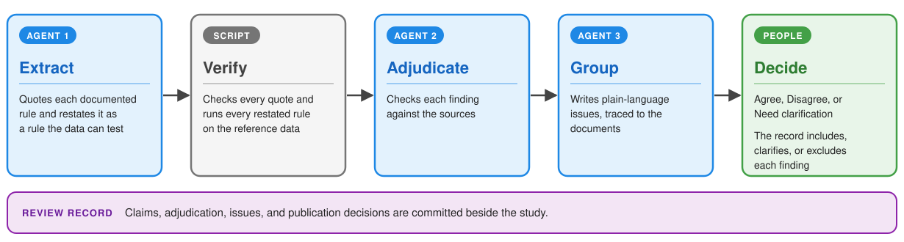

## Takeaways

- **Define the AI-first workflow** with a clear input and output for every
  step.
- **Plain text first, deterministic first:** keep artifacts inspectable, and
  let tested tools, not the model, produce the results.
- **Establish a human baseline with benchmarks** before you trust an agent's
  output.

## Keep going after the course

- **Review a benchmark** in five minutes:
  [Start reviewing](https://elong0527.github.io/yamaa/benchmark/review/next/).
  Each review helps finalize the truth that agents are measured against.
- **Join R Consortium Pilot 7:** the
  [working group](https://rconsortium.github.io/submissions-wg/pilot7.html).
- **Explore a full study:** the
  [Pilot 7 synthetic data](https://github.com/RConsortium/submissions-pilot7-synthetic-data)
  holds complete SDTM and ADaM packages; the Codespace in the appendix has
  yamaa and the agents ready.

## References

- **yamaa:** [repository](https://github.com/elong0527/yamaa),
  [documentation](https://elong0527.github.io/yamaa/),
  [R, Python, and command-line API](https://elong0527.github.io/yamaa/articles/api/),
  and [benchmarks](https://elong0527.github.io/yamaa/benchmark/).
- **Harbor:** the [framework](https://github.com/harbor-framework/harbor) and
  [Harbor Hub](https://hub.harborframework.com/jobs?access=all&owner_org=yamaa).
- **R Consortium:** the
  [Submissions Working Group](https://rconsortium.github.io/submissions-wg/)
  and the
  [Pilot 7 synthetic data](https://rconsortium.github.io/submissions-pilot7-synthetic-data/).
- **FDA:** the
  [draft guidance on AI to support regulatory decision-making](https://www.fda.gov/regulatory-information/search-fda-guidance-documents/considerations-use-artificial-intelligence-support-regulatory-decision-making-drug-and-biological)
  and the CDRH [discussion paper](https://www.fda.gov/media/194242/download)
  on generative AI-enabled devices.

## Questions {background-color="#385898" .center}

::: {.section-brief}
Thank you. Post your questions in the group chat, or open an issue on
[github.com/elong0527/yamaa](https://github.com/elong0527/yamaa/issues).
:::

# Appendix {background-color="#385898"}

## Preparation

This workshop assumes familiarity with the clinical development lifecycle
and CDISC standards, as well as R programming experience.

A preconfigured GitHub Codespace is ready for the workshop:

- [{.codespaces-badge}](https://codespaces.new/elong0527/yamaa)
  + R and common R packages for data standardization.
  + OpenCode, Claude Code, and Codex.

- Start [OpenCode](https://opencode.ai/).
  + Run `/connect` to connect to [OpenCode Go](https://opencode.ai/console/go)
    with the provided API key.
  + Run `/models` to select `opencode-go/muse-spark-1.3-contributor`.
  + Or sign in to the preinstalled [Claude Code](https://code.claude.com/docs/en/quickstart),
    [Codex](https://learn.chatgpt.com/docs/codex/cli), or [Muse code](https://dev.meta.ai/)
    with your own account.

## Verify the GitHub Codespace {.compact}

:::: {.columns}

::: {.column width="50%"}
**Step 1. Check R and yamaa**

Open the Codespace, start R from the terminal, and run:

```r
library(yamaa)
yamaa_selftest()
```

::: {.expect}
**Expect:** the first line reads `yamaa selftest: succeeded`.
:::
:::

::: {.column width="50%"}
**Step 2. Check an AI agent**

Start an agent in the terminal: `opencode`, `claude`, `codex`, or `muse`.
Then ask:

::: {.prompt}
Explain ODM XML and its relationship to EDC systems and CRFs.
:::

::: {.expect}
**Expect:** the agent answers in the terminal.
:::
:::

::::


## yamaa: four components

| Component | Purpose | Links |
| --- | --- | --- |
| Schema | Declares the vocabulary of the specification. | [Repository](https://github.com/elong0527/yamaa/tree/main/yaml) / [Introduction](https://elong0527.github.io/yamaa/articles/schema-intro/) |
| Rules | Defines the meaning of each specification. | [Repository](https://github.com/elong0527/yamaa/tree/main/rules) / [Rules](https://elong0527.github.io/yamaa/articles/rules/) |
| Engine | Runs specifications in Python, R and CLI consistently following the rules. | [Python](https://github.com/elong0527/yamaa/tree/main/python) / [R](https://github.com/elong0527/yamaa/tree/main/R/yamaa) / [CLI](https://github.com/elong0527/yamaa/tree/main/rust/crates/yamaa-cli) |
| Benchmark | Provides runnable specification examples. | [Repository](https://github.com/elong0527/yamaa/tree/main/benchmarks) / [Dashboards](https://elong0527.github.io/yamaa/benchmark/) |


## Open source has reached the regulators

- The R Consortium Submissions Working Group engages directly with the FDA.
  + Seven pilots demonstrate best practices for FDA submissions using R.

:::::::: {.hex-grid}
::: {.hex-item}
[](https://rconsortium.github.io/submissions-wg/pilot1.html)

**Pilot 1**

2021 -- 2022
:::

::: {.hex-item}
[](https://rconsortium.github.io/submissions-wg/pilot2.html)

**Pilot 2**

2022 -- 2024
:::

::: {.hex-item}
[](https://rconsortium.github.io/submissions-wg/pilot3.html)

**Pilot 3**

2023 -- 2024
:::

::: {.hex-item}
[](https://rconsortium.github.io/submissions-wg/pilot4.html)

**Pilot 4a**

2024 -- 2025
:::

::: {.hex-item}
[](https://rconsortium.github.io/submissions-wg/pilot4.html)

**Pilot 4b**

2024 -- 2025
:::

::: {.hex-item}
[](https://rconsortium.github.io/submissions-pilot5-website/)

**Pilot 5**

2025 -- 2026
:::

::: {.hex-item}
[](https://rconsortium.github.io/submissions-wg/pilot6.html)

**Pilot 6**

2026 -- ongoing
:::

::: {.hex-item}
[](https://rconsortium.github.io/submissions-wg/pilot7.html)

**Pilot 7**

2026 -- ongoing
:::
::::::::

## R Consortium Pilot 7: full studies

- Builds a publicly available, agentic workflow for data standardization.
  + <https://rconsortium.github.io/submissions-pilot7-synthetic-data/>
- CDISC pilots (SDTM -> ADaM)
  + CDISCPILOT01 and R Consortium Submission Pilots 3 and 5.
- OpenClinica real sample data (ODM -> SDTM -> ADaM)
  + Real sample data that tests the full data journey.
- Synthetic studies (ODM -> SDTM -> ADaM)
  + ODM XML simulated from real clinical studies.


## Objective: name the decision first

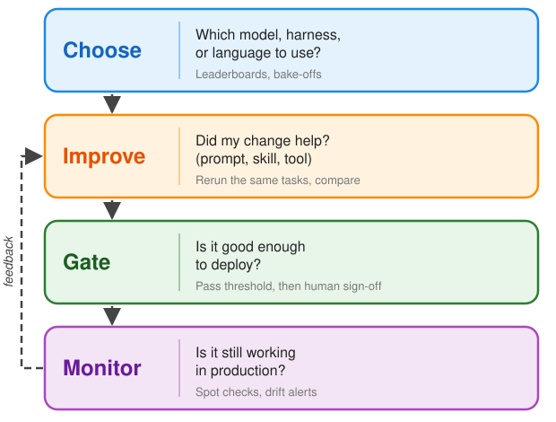


## Intervention: the system you deploy

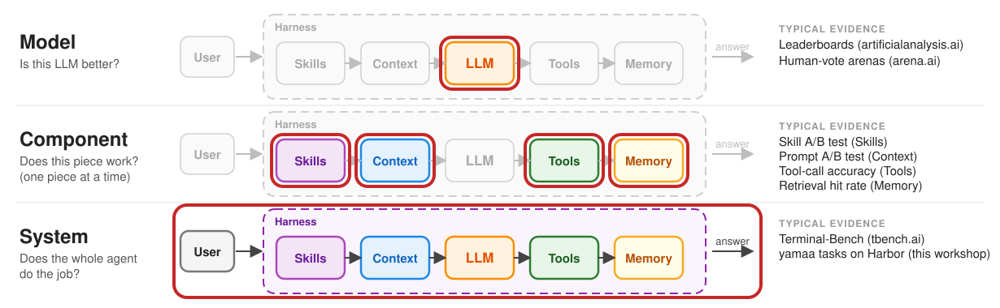

**Evaluate what you deploy: the whole system.** A trial tests the drug product
as patients take it, not the molecule alone; likewise, a top leaderboard model
does not guarantee a working workflow.

## Endpoint: how each task is scored

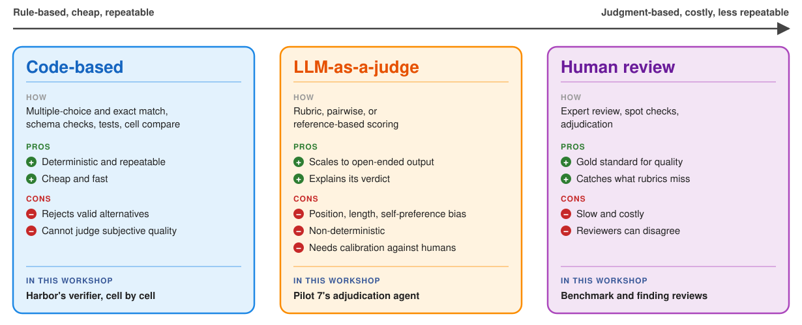

**Mix them:** code where the truth is checkable, an LLM judge to scale the
rest, and people to calibrate and sign off.
