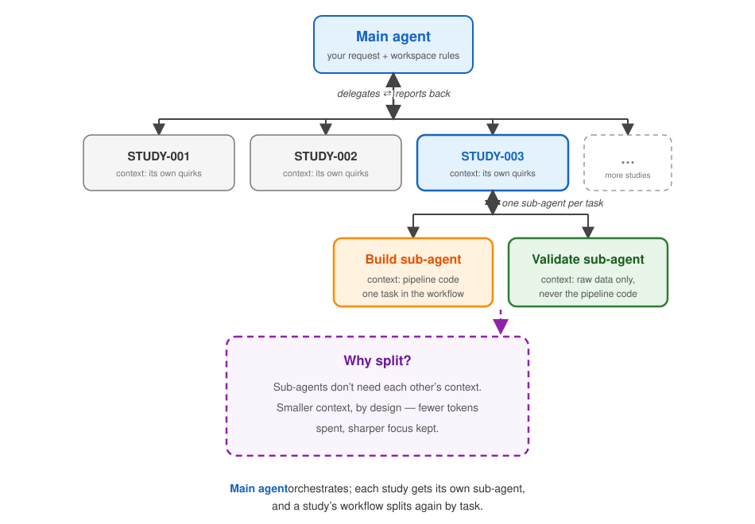
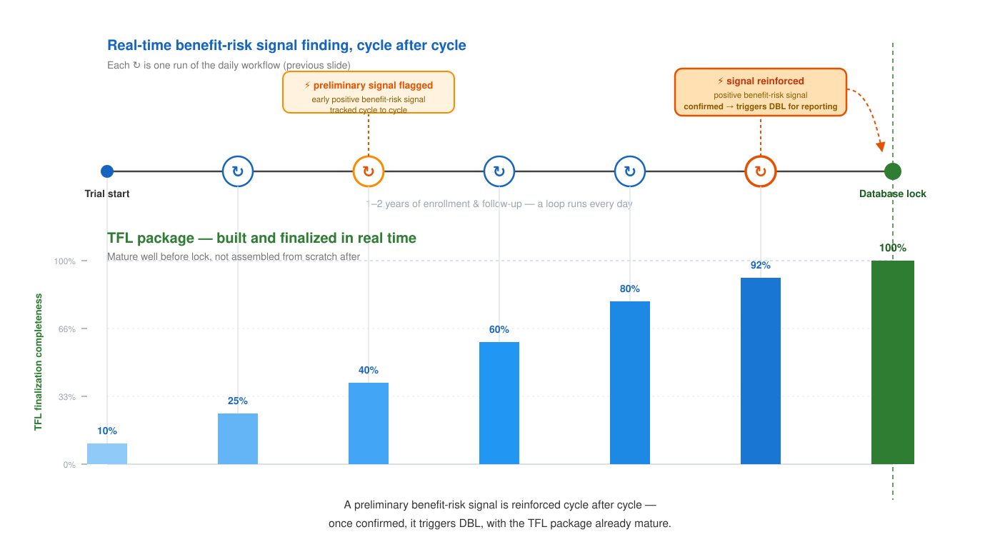
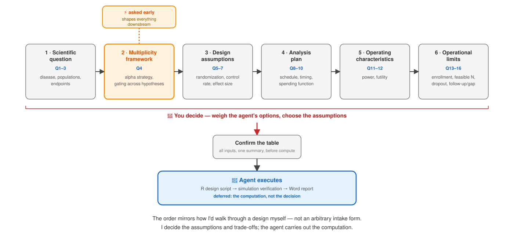
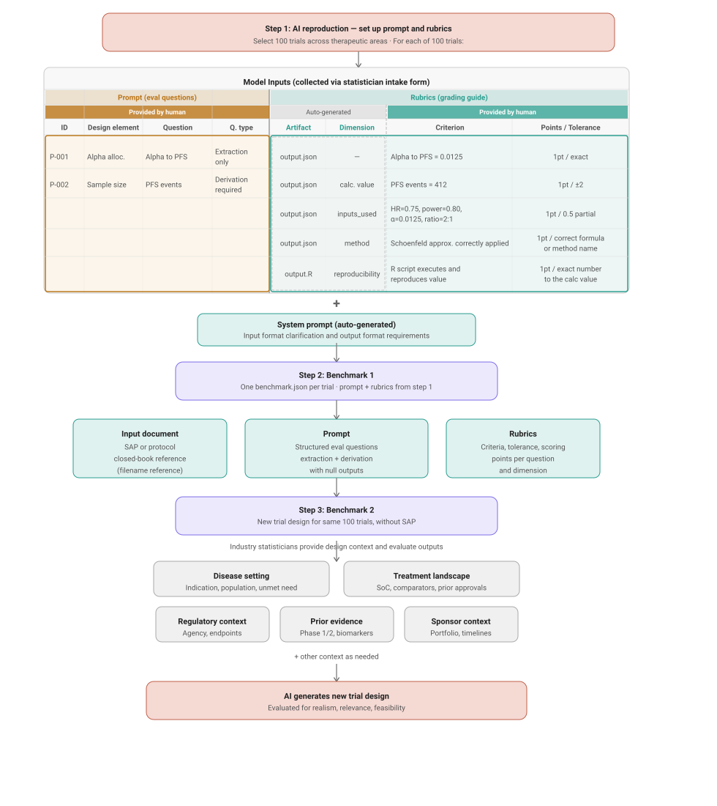
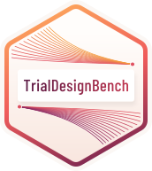

## Part 2 at a glance

::: {.section-brief}
**You will:** see two ways to give an agent the right context for a
domain-specific job — a workflow, shown with medical monitoring; and a
skill, shown with group sequential trial design.<br>
**Format:** talk.
:::

::: {.section-brief .speaker}
Eric Zhang
:::

## Topic 1: A workflow for medical monitoring

**Good agentic workflows start with a good harness**

The harness is everything around the model: structure, memory, delegation,
and checks. Build that well, and the workflow takes care of itself.

:::: {.columns}

::: {.column width="50%"}
1. **Folder structure** — one shape per study
2. **`CLAUDE.md` / `AGENTS.md`** — standing instructions, root + per-study, read every session
3. **Audit trail** — three sources together: git, session log, and the platform's system log
4. **Git** — what changed, diffable and reversible
5. **Session log** — memory, why it changed, enforced by a hook
:::

::: {.column width="50%"}
6. **Sub-agents** — one per task in the workflow, split context
7. **Skills** — domain knowledge, encoded once
8. **Evaluation** — methodological independence, humans stay accountable
9. **Worked example** — the daily dashboard workflow, step by step
:::

::::

## One folder per study, one shape for every study

:::: {.columns}

::: {.column width="55%"}
```text
~/                             workspace root
├── CLAUDE.md                  workspace rules, read every session
├── STUDY-001/
├── STUDY-002/                 one self-contained folder per study
├── STUDY-003/
│   ├── CLAUDE.md                verified study quirks, auto-loaded here
│   ├── data/<snapshot>/         dated EDC cuts, read-only
│   ├── scripts/                 pipeline, report, weekly refresh
│   ├── output/                  dated reports, publish staging
│   └── docs/session_log.md      append-only history
├── .claude/
│   ├── agents/                 separate sub-agent(s) per study
│   ├── skills/                 reusable playbooks
│   └── hooks/                  session-log enforcement
└── ...
```
:::

::: {.column width="45%"}
- **Self-contained.** A study owns its data, scripts, outputs, and docs.
- **Isolated.** Nothing leaks between studies: one study's quirks, fixes,
  and history never enter another's context.
- **Separate sub-agents per study.** Each study gets its own agent — often
  more than one, e.g. build and validate — so its context only ever holds
  that study's facts.
- **Repeatable.** A new study is the same shape, copied.
:::

::::

> Physical isolation is what makes the context isolation reliable: an agent
> working in `STUDY-003/` cannot accidentally see `STUDY-001/`'s data,
> fixes, or history.

## Initialize with one prompt

:::: {.columns}

::: {.column width="55%"}
::: {.prompt}
initialize this folder

(in Claude Code — or the built-in `/init` command)
:::

**Result:** `CLAUDE.md` — what the workspace is, how it's laid out, and the
rules every session must follow.
:::

::: {.column width="45%"}
- **Standing instructions.** Read at the start of every session — no
  re-explaining.
- **A draft, then a contract.** The prompt drafts it from what's already in
  the folder; you edit it into your rules.
- **Grows with decisions.** Layout, data rules, required workflows — every
  decision worth keeping gets written in.
- **Root + per-study.** A short root file for workspace-wide rules; each
  study folder gets its own for that study's quirks, auto-loaded only
  there.
:::

::::

> Chat forgets. `CLAUDE.md` doesn't.

## The audit trail: three layers

| Layer | Answers | Written by |
| --- | --- | --- |
| **Git** | What changed? | The agent, one commit per change |
| **Session log** | Why did it change? | The agent, enforced by a hook |
| **Platform system log** | Who was in the system, and when? | The platform itself (e.g. Workbench), independent of the agent |

> No single layer has to be trusted alone: what the agent changed, why it
> changed it, and who could have touched the system at all — from three
> different sources.

The platform's own system log needs no building: logins and sessions are
already recorded by the infrastructure (e.g. Posit Workbench), independent
of anything the agent does. Git and the session log are what you build on
top of it.

## Git: what changed

:::: {.columns}

::: {.column width="55%"}
```text
$ git log --oneline -5
a1b2c3d fix: detect the newest snapshot instead of a hardcoded default
9f8e7d6 feat: add a PP record to ADVS per the study SAP
7c6d5e4 fix: round AVAL per protocol convention, not language default
3b2a1f0 docs: record the baseline-derivation rule in CLAUDE.md
0e9d8c7 chore: initialize STUDY-003 from the workspace template
```
:::

::: {.column width="45%"}
- **Every change is a commit.** Code, `CLAUDE.md`, skills, specs — one
  history, diffable and reversible.
- **Same discipline as a human PR.** The agent stages named files and
  writes a message; a human's say-so is still required for anything
  destructive — force-push, `reset --hard`, skipping hooks.
- **One source of truth.** The same principle behind yamaa's
  version-controlled specification applies to the whole workspace.
:::

::::

> If a change isn't committed, it isn't real yet.

## Give the agent a memory — a log file

:::: {.columns}

::: {.column width="55%"}
```text
STUDY-003/docs/session_log.md          append-only
⋮
## 2026-11-09
- Snapshot mislabel: the "Nov 9" refresh read the Nov 3 cut.
  Root cause: hardcoded snapshot default; refresh passed no argument.
  Fixed: newest snapshot detected and passed explicitly.
- Rebuilt on the correct snapshot; flags 43 → 50 (3 resolved, 4 new).
- Independent validation (10th pass): PASS — zero errors.
- OPEN: access for the second reviewer.
⋮
```
:::

::: {.column width="45%"}
- **Two layers.** A hook auto-lists every file touched; the agent writes
  the why — decisions, fixes, open questions.
- **Enforced.** After code changes, the hook blocks the session from ending
  until the entry is written.
- **Memory across sessions.** The next session — or a colleague — reads
  what happened and why.
:::

::::

> Hooks are your own scripts, run automatically on session events: build
> your own guardrails. Anything you want the agent to *always* do, make it
> a hook, not a reminder.

**If it isn't written down, the next session doesn't know it.**

## Sub-agents: one per task in the workflow

:::: {.columns}

::: {.column width="65%"}
{width="100%"}
:::

::: {.column width="35%"}
- **You don't hand-write these.** Say "create a sub-agent for the
  STUDY-003 dashboard" and the main agent drafts it; you review and
  refine it.
- **Context never carries back up.** The main thread gets only the final
  report — one validation run recomputed everything from raw data across
  roughly 270,000 tokens; the main thread received a two-page summary.
- **Validation gets deliberately less context than development** — raw
  data only, never the pipeline code. That independence is what makes a
  PASS meaningful.
:::

::::

## Encode domain knowledge as skills

:::: {.columns}

::: {.column width="55%"}
```text
~/.claude/skills/
├── medical-monitoring-report/   the dashboard playbook
│   ├── SKILL.md                 when it triggers, the method
│   └── references/              architecture, interactivity, validation
├── recist-confirmation/         RECIST 1.1 confirmed-response rules
├── group-sequential-design/     trial-design Q&A workflow
├── gsdose/                      seamless phase 2/3 dose-selection designs
└── km-digitizer/                digitize published KM curves
```
:::

::: {.column width="45%"}
- **What is a skill?** A playbook the agent loads whenever the task
  matches: triggers, method, references, scripts. Written once by the
  expert; followed every session after.
- **Example: ADaM derivation order.** A skill encodes the order: build the
  intermediate `ADINTDT` before `ADTTE`, which depends on it — not the
  reverse.
- **Claude helps you write them.** A built-in skill-creator skill
  interviews you, drafts the `SKILL.md`, and tests it.
:::

::::

> A prompt asks for an outcome. A skill defines how it's always done.

## Evaluation: methodological independence

Evaluation runs on the same harness you just built:

:::: {.columns}

::: {.column width="33%"}
**A separate evaluator**

Uses sub-agents. A fresh sub-agent that never built the thing — raw data
only, never the pipeline code. It recomputes; it doesn't re-read.
:::

::: {.column width="33%"}
**A validation skill**

Uses skills. The same checks, every time: recompute every number from
raw, check cross-output consistency, fix before shipping.
:::

::: {.column width="34%"}
**Failure patterns on file**

Uses the audit trail. Past failures live in the session log; every new
evaluation checks for the mistakes already made once.
:::

::::

> The agent evaluates; a human signs off. Nothing ships on an agent's
> PASS alone — we own what ships.

## Worked example: the daily dashboard workflow {.compact}

::: {.ai-native}
::: {.ai-native-label}
AI-native
:::
::: {.skill-label}
skill: medical-monitoring-report
:::

::: {.flow .flow-5}
::: {.flow-step .fragment}
Cron
[scheduled trigger]{.small}
:::
::: {.flow-step .build .fragment}
Extract &#129302;&#128736;
[the day's EDC snapshot]{.small}
:::
::: {.flow-step .build .fragment}
Build &#129302;&#128736;
[pipeline + lineage graph]{.small}
[skill ref: architecture]{.tag}
[skill: RECIST 1.1]{.tag}
:::
::: {.flow-step .build .fragment}
Assemble &#129302;&#128736;
[interactive HTML]{.small}
:::
::: {.flow-step .build .fragment}
Summary &#129302;&#128736;
[updates + data issues]{.small}
:::
:::

::: {.flow .flow-4}
::: {.flow-step .validate .fragment}
Validate &#129302;&#128269;
[recompute from raw]{.small}
[skill ref: validation]{.tag}
:::
::: {.flow-step .adjudicate .fragment}
Adjudicate &#129302;&#9878;&#65039;
[resolve flagged items]{.small}
[skill ref: validation]{.tag}
:::
::: {.flow-step .fragment}
Publish &#129302;
[one stable URL]{.small}
:::
::: {.flow-step .fragment}
Notify &#129302;
[reviewers alerted]{.small}
:::
:::

::: {.audit-bar .fragment}
Git + session log — every step logged
:::
:::

::: {.human-review .fragment}
**Human review** &#128100; — outside the AI-native loop. Sign-off required.
:::

::: {.highlight-note .fragment}
Sub-agents for Build, Validate, and Adjudicate are each guided by a skill.
:::

## Across the trial: a TFL package that matures toward lock

The daily workflow on the previous slide doesn't run once — it repeats for
the life of the trial, giving two things in real time:

- **Real-time benefit-risk signal finding** — a preliminary positive signal
  is tracked cycle to cycle; once it's reinforced, that's what triggers
  database lock for reporting, not a fixed calendar date.
- **Real-time TFL finalization** — every cycle also adds to one persisting
  TFL package, so it's already mature by the time the database locks,
  instead of being assembled from scratch after.
- **The harness itself can be packaged and shared.** The AI-native harness
  you build in your working directory can naturally be packaged as a
  skill or an MCP server — served up as a plug-in another agency can
  connect to their own AI system.

:::: {.columns}

::: {.column width="100%"}
{width="100%"}
:::

::::

## Recap: context for the medical monitoring workflow

- **Context guides the agent on when to use which tool.** CLAUDE.md,
  skills, and the session log don't just hand the agent tools — they tell
  it when each one applies, so it reaches for the right one at the right
  step.
- **Context and tools are both areas domain experts can shape.** For
  example, making your organization's GitHub repo of templates, specs,
  and conventions available to the agent as a tool.
- **Skills, hook-written logs, and sub-agents sharpen that context** — one
  skill per domain task, one log entry per hooked event, one sub-agent per
  task in the workflow — so every step runs with just the context it needs.

## Topic 2: Building skills to bring domain knowledge into context

**A skill packages domain knowledge once — then any agent can use it.**

Where a workflow wires together the steps of one task, a skill teaches the
agent what a domain expert already knows: the method, its assumptions, and
when it applies. This topic shows it with group sequential design for
survival trials.

- **What a skill is** — not a tool, but a packaged how-to: methodology,
  templates, and the questions to ask before computing anything.
- **Why group sequential design** — it's a method where domain experts
  have their own design philosophy: how to collect design inputs, and in
  what order. A skill turns that philosophy into a playbook, reflecting
  how they'd approach the design themselves.
- **Worked example** — turning a group sequential design skill into a
  structured Q&A the agent runs with you.

## Demo: the group sequential design skill in action

::: {.demo-feature}
🎥

[Watch the skill run a design end to end](https://drive.google.com/file/d/1fW2CuVbp9XLnt1J6DwzsfKOtgABFPZ8t/view?usp=drive_link)

Q&A &#8594; R design script &#8594; simulation verification &#8594; Word report + reproducible R/Python scripts
:::

## A skill for group sequential design

Given a trial scenario, the [group sequential design
skill](https://github.com/RConsortium/pharma-skills/tree/main/group-sequential-design)
designs a group-sequential survival-endpoint trial — boundaries, sample
size, and multiplicity strategy — through a guided Q&A, verifies the
result by simulation, and delivers reproducible R/Python scripts
alongside the Word report.

:::: {.columns}

::: {.column width="50%"}
**Skill structure**

```text
group-sequential-design/
├── SKILL.md            Q&A workflow, design steps
├── reference.md         design rules, spending fns, alpha recycling
├── examples.md          R code by design pattern
├── post_design.md       timing checks, verification
└── scripts/
    ├── compute_event_prob.R
    └── gsd_report_template.py
```
:::

::: {.column width="50%"}
**Output structure**

```text
output/gsd_{disease}_{endpoints}_{date}/
├── gsd_design.R
├── gsd_results.json
├── multiplicity_diagram.png
├── gsd_verification.R
├── gsd_verification_log.md
├── gsd_report.py
└── gsd_report.docx
```

[`.R` / `.py` scripts — rerun to reproduce every number in the report]{.small}
:::

::::

> Loaded progressively — each reference is only pulled into context when
> the workflow reaches that step.

## The skill's questions are my design philosophy

The skill asks its questions one at a time, in a fixed order. That order
isn't arbitrary — it's what design inputs I need, and in what sequence,
to walk through a group sequential design the way I actually would.

:::: {.columns}

::: {.column width="100%"}
{width="100%"}
:::

::::

## Benchmarking the skill: with vs. without

Any addition to an agent — skill, tool, workflow — should be benchmarked
with-vs-without, not assumed to help.
[21 design scenarios, skill vs. no-skill](https://github.com/RConsortium/pharma-skills/issues/146)
— overall scorecard, best-with-skill run per scenario:

| | With skill | Without skill |
| --- | --- | --- |
| Skill wins | 16 | — |
| Ties | 4 (#3, #21, #60, #113) | — |
| No-skill wins | 1 (#139) | — |
| Avg score (excl. #60, trivial) | **90%** | **62%** |

:::: {.columns}

::: {.column width="33%"}
**1 · Does it add value?**

16/21 wins, 4 ties, 1 loss (#139 — a structural gap, fix in progress).
:::

::: {.column width="33%"}
**2 · How good with the skill?**

90% average vs. 62% without, at each scenario's best run.
:::

::: {.column width="34%"}
**3 · Failure patterns**

P0: a four-arm, contribution-of-components design.
:::

::::

## Best practices for building a skill

:::: {.columns}

::: {.column width="50%"}
**1 &#183; Structured Q&A completes the prompt**

A skill's intake isn't boilerplate — it's prompt engineering. Ask one
question at a time, in the order that matters, and the prompt is
complete before any computation starts.
:::

::: {.column width="50%"}
**2 &#183; Document failure patterns**

Record what's gone wrong before — a structural gap, a wrong formula, a
missed edge case — so the skill stops the agent from repeating a mistake
it already made once.
:::

::::

:::: {.columns}

::: {.column width="50%"}
**3 &#183; Progressive disclosure**

Don't front-load everything. Reference files load only when the workflow
reaches that step — most of the skill never enters context at all.
:::

::: {.column width="50%"}
**4 &#183; Scripts for deterministic steps**

Anything with one right answer — event calculations, report generation —
belongs in a script the agent runs, not in text the agent reasons through.
:::

::::

> A skill is prompt engineering, not a prompt. Treat the intake, the
> failure modes, the context budget, and determinism as first-class
> design choices — not afterthoughts.

## TrialDesignBench

The skill benchmark above is one case study inside a larger effort:
evaluating whether AI agents can **reproduce** or **design** clinical
trial statistical designs at all.

:::: {.columns}

::: {.column width="45%"}
- **Benchmark 1** — reproduce a design, closed-book, from the SAP/protocol
- **Benchmark 2** — design the same trial with no SAP, only context
  (disease, treatment, regulatory, sponsor)

[Full workflow spec](https://github.com/BBSW-org/TrialDesignBench/issues/4)
:::

::: {.column width="55%"}
{width="100%"}
:::

::::

## Building the benchmark

:::: {.columns}

::: {.column width="33%"}
**1 · Intake form**

Statisticians write design questions and rubrics for a trial.

[HuggingFace Space](https://huggingface.co/spaces/trialdesignbench/tdb-intake)
:::

::: {.column width="33%"}
**2 · Benchmark review**

A QA pass on submitted cases before they enter the benchmark.

[HuggingFace Space](https://huggingface.co/spaces/trialdesignbench/tdb-intake)
:::

::: {.column width="34%"}
**3 · Evaluation framework**

Runs models against the benchmark, scores outputs against rubrics.

[Built on Harbor](https://bbsw-org.github.io/TrialDesignBench/)
:::

::::

## Example: question &#8594; rubric &#8594; grade

KN189 (KEYNOTE-189), P-004 — derivation question:

> "What is the total required number of PFS events at its final analysis
> based on Lachin and Foulkes' method for the variance estimation?"

:::: {.columns}

::: {.column width="33%"}
**Inputs used**

- Target HR = 0.7 [&#10003; +1]{.pass}
- Randomization ratio 2:1 [&#10003; +1]{.pass}
:::

::: {.column width="33%"}
**Calculated value**

- PFS events at IA2 &#8776; 468 &#177;3 [&#10007; 0]{.fail}

[Model derived 472 — out of tolerance]{.small}
:::

::: {.column width="34%"}
**Method**

- Fixed design via Lachin&#8211;Foulkes [&#10003; +2]{.pass}
- L-F uses event fractions, not allocation fractions [&#10007; 0]{.fail}
:::

::::

> Model scored **13 / 18** on this prompt.

## Where we are

:::: {.columns}

::: {.column width="30%"}
{width="70%"}
:::

::: {.column width="70%"}
::: {.progress-stat}
**26 / 50 trials** toward the target benchmark size

<div class="progress-bar"><div class="progress-fill" style="width:52%"></div></div>

[toward the target benchmark size]{.progress-label}
:::

**We'd love your help.** Write a test case — question and rubrics — from
a protocol or SAP you know well, and help stress-test AI on real trial
design.

&#11088; [github.com/BBSW-org/TrialDesignBench](https://github.com/BBSW-org/TrialDesignBench)
:::

::::

## Recap: skills sharpen domain-specific context

- **Use skills to sharpen the domain-specific context an agent gets.** The
  group sequential design skill encoded what inputs to collect, in what
  order, and how to compute and verify the result — my design philosophy,
  made reusable.
- **Agents like Claude Code ship a built-in skill for building skills.**
  skill-creator interviews you, drafts the `SKILL.md`, and tests it — you
  don't start from a blank page.
- **Build a benchmark for any mission-critical skill — don't assume it
  helps.** With-vs-without, like TrialDesignBench did here: 90% vs. 62%.

